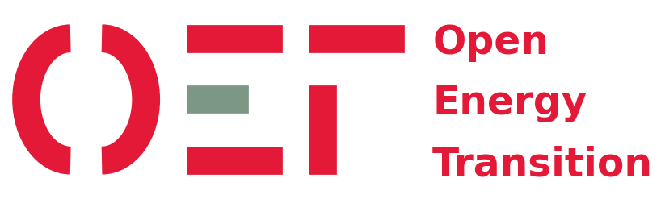
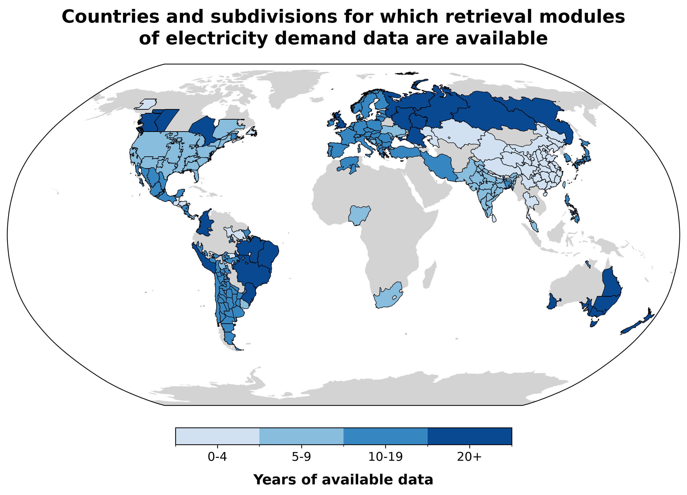

<h1 align="center"><b>DemandCast</b></h1>

<h2 align="center"><b>Global hourly electricity demand forecasting</b></h2>

    
    
    
    
    

<h3 align="center"><b>A project developed by</b></h3>

    

<h3 align="center"><b>Supported by</b></h3>

    

DemandCast collects hourly electricity demand, weather and socio-economic data from public sources, cleans and combines the electricity demand, and trains machine learning models that generate hourly time series of the gross electricity demand for future years, or for countries and subdivisions without data, to support energy planning studies.

<!-- status:start -->
As of 25 November 2026, DemandCast has retrieval modules for the hourly electricity demand of **46 countries and 194 subdivisions**, in 76 countries, from **47 data sources**, with about **2,175 years of data** in total since 1994, in the periods that the data sources cover, before the cleaning and the selection of the complete years for training.
<!-- status:end -->

The trained model and the forecasted hourly electricity demand of 184 countries and 135 subdivisions from 2000 to 2025 are in this [Zenodo repository](https://doi.org/10.5281/zenodo.18374351).

## Documentation

The [documentation](https://open-energy-transition.github.io/demandcast/) describes DemandCast, its data sources and its [current state](https://open-energy-transition.github.io/demandcast/status/), and has the [getting started guide](https://open-energy-transition.github.io/demandcast/getting_started/) and the [architecture](https://open-energy-transition.github.io/demandcast/architecture/) of the code. To contribute, read the [contributing guidelines](CONTRIBUTING.md).

## Citation

If you use DemandCast in your work, please cite the [paper](https://arxiv.org/abs/2510.08000). [CITATION.cff](CITATION.cff), behind GitHub's "Cite this repository" button, gives the reference, and the [documentation](https://open-energy-transition.github.io/demandcast/#citation) its BibTeX.

## License

This project is licensed under the GNU Affero General Public License v3.0 (AGPL-3.0).
