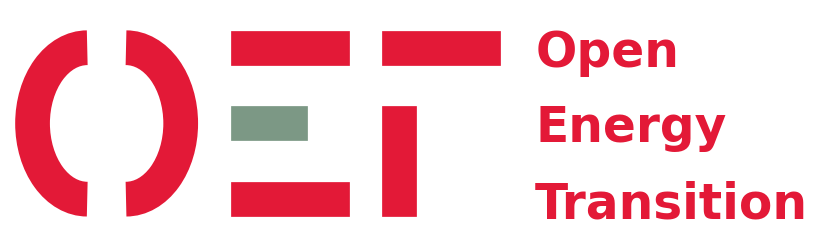
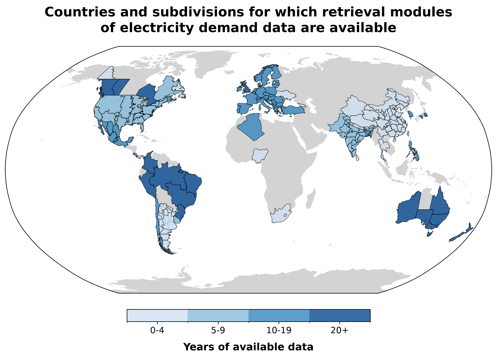

<h1 align="center"><b>DemandCast</b></h1>

<h2 align="center"><b>Global hourly electricity demand forecasting</b></h2>

<p align="center">
    <a href="https://github.com/open-energy-transition/demandcast/actions/workflows/ci.yml"></a>
    <a href="https://arxiv.org/abs/2510.08000"></a>
    <a href="https://doi.org/10.5281/zenodo.18374351"></a>
    <a href="https://scorecard.dev/viewer/?uri=github.com/open-energy-transition/demandcast"></a>
    <a href="https://github.com/open-energy-transition/demandcast/blob/main/LICENSE"></a>
</p>

<h3 align="center"><b>A project developed by</b></h3>

<p align="center">
    <a href="https://openenergytransition.org/">
        
    </a>
</p>

<h3 align="center"><b>Supported by</b></h3>

<p align="center">
    <a href="https://www.breakthroughenergy.org/">
        
    </a>
</p>

## About

DemandCast collects hourly electricity demand, weather and socio-economic data from public sources, cleans and combines the electricity demand, and trains machine learning models that generate hourly time series of electricity demand for future years, or for countries and subdivisions without data, to support energy planning studies.

DemandCast models the **gross electricity demand**: the electricity consumed, whatever generation supplies it, including the part that rooftop solar and other generation embedded in the distribution networks supply. Energy system models can then represent that generation explicitly, without counting it twice. Where a data source leaves it out, DemandCast adds an estimate of it when one is published, and flags the series otherwise (see [Data Retrieval](https://open-energy-transition.github.io/demandcast/retrieval/#gross-demand)).

## Current state

<!-- status:start -->
As of 23 October 2026, DemandCast has retrieval modules for the hourly electricity demand of **58 countries and 130 subdivisions**, in 67 countries, from **42 data sources**, with about **1,591 years of data** in total since 1994.
<!-- status:end -->

<picture>
  <source media="(prefers-color-scheme: dark)" srcset="webpage/docs/status/available_entities_dark_mode.png">
  <source media="(prefers-color-scheme: light)" srcset="webpage/docs/status/available_entities_light_mode.png">
  
</picture>

- The [current state](https://open-energy-transition.github.io/demandcast/status/) page shows the data by GDP and electricity demand per capita, and the forecast errors of the models.
- The [data sources](https://open-energy-transition.github.io/demandcast/#data-sources) of each type of data are listed in the documentation.
- The electricity demand that we retrieved is in this [Google Cloud Storage bucket](https://console.cloud.google.com/storage/browser/demandcast_data).
- The forecasted hourly electricity demand of 184 countries from 2000 to 2024 is in this [Zenodo repository](https://doi.org/10.5281/zenodo.18374351).

## Documentation

- [Documentation](https://open-energy-transition.github.io/demandcast/), with the [getting started guide](https://open-energy-transition.github.io/demandcast/getting_started/) and the [architecture](https://open-energy-transition.github.io/demandcast/architecture/) of the code.
- [Paper](https://arxiv.org/abs/2510.08000) accepted at the [NeurIPS 2025 Workshop](https://www.climatechange.ai/papers/neurips2025/42): Tackling Climate Change with Machine Learning, with its [poster](https://s3.us-east-1.amazonaws.com/climate-change-ai/papers/neurips2025/42/poster.pdf) and [video presentation](https://slideslive.com/39052515/demandcast-global-hourly-electricity-demand-forecasting).

## Quick start

With [uv](https://docs.astral.sh/uv/getting-started/installation/) installed:

```bash
git clone https://github.com/open-energy-transition/demandcast.git
cd demandcast/demandcast
uv sync
uv run retrieve.py  # the settings are in config/retrieve_config.yaml
```

Some data sources need API keys. The [getting started guide](https://open-energy-transition.github.io/demandcast/getting_started/) sets them up and goes from the retrieval of the data to a forecast.

## Contributing

We welcome new data sources, models, bug fixes, tests and documentation. Please read the [contributing guidelines](CONTRIBUTING.md) and follow our [Code of Conduct](CODE_OF_CONDUCT.md). Issues labelled [good first issue](https://github.com/open-energy-transition/demandcast/labels/good%20first%20issue) are a good place to start, and you can share your feedback in this short [survey](https://forms.gle/nMYvCAfzbrUDjqRQ8).

## Citation

If you use DemandCast in your work, please cite the [paper](https://arxiv.org/abs/2510.08000). GitHub's "Cite this repository" button, generated from [CITATION.cff](CITATION.cff), provides the reference in other formats.

```bibtex
@inproceedings{steijn2025demandcast,
  title     = {DemandCast: Global hourly electricity demand forecasting},
  author    = {Steijn, Kevin and Goli, Vamsi Priya and Antonini, Enrico},
  booktitle = {NeurIPS 2025 Workshop: Tackling Climate Change with Machine Learning},
  year      = {2025},
  doi       = {10.48550/arXiv.2510.08000},
  url       = {https://arxiv.org/abs/2510.08000}
}
```

## Maintainers

The project is maintained by the [Open Energy Transition](https://openenergytransition.org/) team. The team members currently involved in this project are:

- [Enrico Antonini](https://github.com/eantonini) (enrico.antonini at openenergytransition dot org)
- [Vamsi Priya Goli](https://github.com/Vamsipriya22) (goli.vamsi at openenergytransition dot org)

## License

This project is licensed under the GNU Affero General Public License v3.0 (AGPL-3.0).
