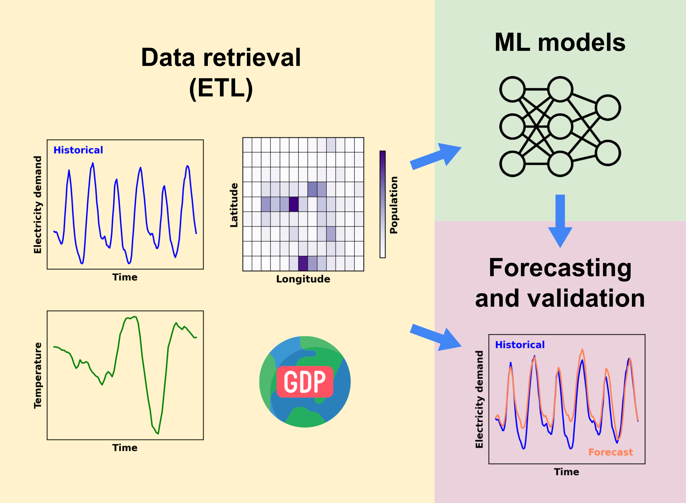

# Architecture

DemandCast is a set of scripts, each configured by a YAML file, that pass their data to each other through the files of a data folder. This page describes the scripts, the folders of the code and of the data, and how the modules depend on each other. To add a data source or a model, see the [contributing guidelines](https://github.com/open-energy-transition/demandcast/blob/main/CONTRIBUTING.md).



## Scripts

The scripts are in the `demandcast/` folder and run from it, with `uv run <script>.py`. Each one reads its settings from `config/<script>_config.yaml`, or from the file given with `--config`, and checks them with a pydantic model before it starts.

| Script | What it does | Reads | Writes |
|---|---|---|---|
| `retrieve.py` | Downloads a variable: the electricity demand of a data source, which it then cleans and combines, the population, GDP PPP per capita and annual electricity demand per capita, their gridded data, the gridded weather and the temperature | The data sources | The folder of the variable |
| `check.py` | Checks the data availability, the data sources over the network, or gathers the flags of the cleaned electricity demand into a report | The data folder, the data sources | `results/checks/`, and the summary of the data availability in the `checks/` folder of the code, which tells the other scripts which codes have all the data |
| `assemble.py` | Assembles the variables of each country and subdivision into one dataset, for training or forecasting | The folders of the variables | `assembled/` |
| `train.py` | Trains a model | `assembled/` | `models/<algorithm>/` |
| `validate.py` | Validates a model on the most recent year of each country and subdivision | `assembled/`, `models/` | `results/validation/` |
| `cross_validate.py` | Validates a model on the countries and subdivisions left out of its training | `assembled/` | `results/cross_validation/` |
| `forecast.py` | Forecasts the hourly electricity demand with a trained model | `assembled/`, `models/` | `results/forecasts/` |
| `plot.py` | Draws the figures of the data availability and of the results of the models | The data folder | `results/figures/` |
| `upload.py` | Uploads the data to Google Cloud Storage or Zenodo | The data folder | The bucket or the Zenodo record |

`benchmark/run.py` runs the retrieval and the assembly of the data of the [benchmark](ML.md#benchmark-results) of the models. The [data retrieval](retrieval.md) and [machine learning](ML.md) pages describe each step.

## Code folder

```
demandcast/                         # the repository
├── .github/                        # GitHub workflows and templates
├── demandcast/                     # the Python project
│   ├── benchmark/                  # Configuration and runner of the data of the benchmark of the models
│   ├── checks/                     # Checks of the data availability, the data sources and the flags
│   ├── cleaning/                   # Cleaning, flags and combination of the electricity demand
│   ├── config/                     # Configuration files of the scripts and lists of countries and subdivisions
│   ├── data/                       # Data, models, results and logs written by the scripts (not in the repository)
│   ├── figures/                    # Figures of the data availability and of the results of the models
│   ├── ml_models/                  # Machine learning models, their registry, data preparation and evaluation
│   ├── retrievals/                 # Retrieval of each variable, and the modules and YAML files of the data sources
│   ├── shapes/                     # Scripts that make the shapes of non-standard subdivisions, and the shapes
│   ├── tests/                      # Tests, in folders that mirror the code
│   ├── utils/                      # Shared helpers: paths, catalogue, codes, data sources, fetching, time series
│   ├── Dockerfile                  # Docker image of the project
│   ├── pyproject.toml              # Project configuration and dependencies
│   ├── uv.lock                     # Locked dependencies
│   └── <script>.py                 # The scripts above
├── webpage/                        # This documentation (MkDocs)
├── AGENTS.md                       # Instructions for AI coding agents
├── CITATION.cff                    # Citation metadata
├── CODE_OF_CONDUCT.md              # Code of Conduct
├── CONTRIBUTING.md                 # Guide to contributing
├── README.md                       # Project overview
└── ruff.toml                       # Ruff configuration
```

The API keys go in `demandcast/.env`, which is not in the repository (see [getting started](getting_started.md#13-configure-environment-variables)).

## Data folder

Everything that the scripts write is in the data folder: `demandcast/data/`, or the folder named by the environment variable `DEMANDCAST_DATA_FOLDER`. Each dataset has its own folder, with its stages:

```
data/
├── electricity_demand/
│   ├── raw/                        # Responses and manifests, by data source
│   │   └── manual_downloads/       # Files downloaded by hand
│   ├── processed/                  # Demand of each data source and country or subdivision
│   ├── cleaned/                    # Cleaned demand, with its flags
│   └── combined/                   # One series of each country or subdivision, from all its data sources
├── gridded_weather/, gridded_population/, gridded_gdp_ppp/
│   ├── raw/                        # Global grids, as downloaded
│   └── processed/                  # Grids of each country and subdivision
├── temperature/, population/, gdp_ppp_per_capita/, annual_electricity_demand_per_capita/
├── assembled/
├── models/<algorithm>/
├── results/
│   ├── validation/, cross_validation/, forecasts/
│   ├── figures/
│   └── checks/                     # Reports of the checks
└── logs/
```

The [data retrieval](retrieval.md#electricity-demand) page describes the stages of the electricity demand. The functions of `utils/paths.py` give these paths: the code uses them instead of writing the paths again.

## Dependencies

The scripts use the packages, and the packages use `utils/`:

```
scripts (retrieve.py, assemble.py, train.py, ...)  and  benchmark/
    └── retrievals/, cleaning/, checks/, figures/, ml_models/
            └── utils/
```

The modules of `utils/` import none of the packages and scripts above them, so that they can be used and tested alone; `tests/utils/test_dependencies.py` checks it. Among the packages, the retrieval of the electricity demand (`retrievals/electricity_demand.py`) cleans and combines it with `cleaning/`, the combination reads the reviews of the flags of `checks/flags.py`, and the check of the data availability and its figure read the annual data with the modules of `retrievals/`.

Each list that the code needs is written once:

- `utils/paths.py`: the folders and files of the code and of the data;
- `utils/catalogue.py`: the scenarios, climate models and years of each projection and gridded dataset;
- `utils/codes.py` and `utils/time_zones.py`: the ISO codes, names, continents and time zones of the countries and subdivisions;
- `utils/data_sources.py`: the registry of the data sources, from their YAML files;
- `ml_models/registry.py`: the models and the interface of their modules;
- `retrieve.py` and `assemble.py`: the retrieval of each variable (`RETRIEVALS`) and the inputs of the assembled datasets (`DATASETS`).

To add a variable to the assembled datasets, add a row to `DATASETS`; to add a data source or a model, follow the [contributing guidelines](https://github.com/open-energy-transition/demandcast/blob/main/CONTRIBUTING.md).
