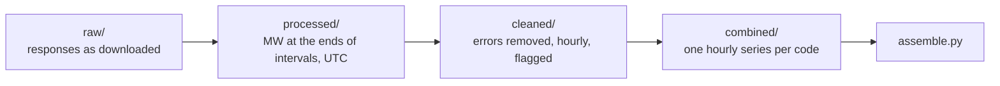

# Electricity demand data

This page explains what happens to the electricity demand of a data source between its download by `retrieve.py` and its use by `assemble.py`: the files in `data/electricity_demand/`, and why some values or hours are missing.

## The four stages

Each stage has its own folder in `data/electricity_demand/` (or in the folder named by `DEMANDCAST_DATA_FOLDER`).



| Stage | Files | What it holds |
|---|---|---|
| Raw | `raw/<data source>/files/`, `manifest.json` | Every response of the source, with every version kept (see [Raw data and versions](../guides/retrieve.md#raw-data-and-versions)) |
| Processed | `processed/<code>_<data source>.parquet` | The demand of one source for one code, in MW, at the source's resolution |
| Cleaned | `cleaned/<code>_<data source>.parquet`, `..._removed.parquet`, `..._flags.parquet` | The demand without impossible values, averaged to hours, with the removed values and the flags |
| Combined | `combined/<code>.parquet`, `<code>_sources.parquet`, `<code>_flags.parquet` | One hourly series per [entity](glossary.md#entity), joined from all its sources |

`<code>` is the code of the country or subdivision, such as `FRA` or `USA_CAL`; `<data source>` is the source's module, such as `entsoe`. [The data folder](../reference/data-folder.md#electricity-demand) lists which script writes and reads each file.

For each code, `retrieve.py` downloads the requests (or replays the raw data with `offline: true`), then processes, cleans, flags and combines. If a source has no data for a code, the log warns, nothing is saved, and the files of earlier retrievals stay.

## Processed data

1. Each version of each request is read again from its responses. The source's module returns the demand in MW at time-zone-aware times that mark the end of each interval. Values that are not numbers stop the code with a `TypeError`.
2. The times are converted to UTC and stored without time zone.
3. Missing times, missing values, values of exactly zero and repeated times are dropped (the first value of a repeated time is kept). Negative values stay until the cleaning.
4. The newest version of a request gives the values; older versions fill only the times that it no longer has. So data that a source later removes is kept.
5. Where several requests give the same time, the version first retrieved most recently wins.
6. Only the values within the entity's dates in the source's YAML file are kept: their interval ends after local midnight at the start of `start_date`, and no later than local midnight at the end of `end_date` (no limit for `today`). So a country can keep only the dates not covered by its subdivisions.

An older version whose values a new download repeats unchanged is removed from the raw data.

| Column | Meaning |
|---|---|
| `Time (UTC)` (index) | End of the interval, UTC without time zone |
| `Load (MW)` | Average demand over the interval |
| `Retrieved` | When the version of this value was first retrieved, such as `2026-10-19T13:09:10Z` |

## Gross and net demand

DemandCast models the [gross demand](glossary.md#gross-demand): all the electricity consumed, whatever supplies it. Many system operators publish only the demand on their network, the [net demand](glossary.md#net-demand), which leaves out the part supplied by [embedded generation](glossary.md#embedded-generation) such as rooftop solar.

As rooftop solar grows, net demand at midday falls year after year. A model trained on it would learn the installed solar, not the consumers, and energy system models that represent this generation would count it twice ([issue #280](https://github.com/open-energy-transition/demandcast/issues/280)). So DemandCast:

- records what each source counts, period by period, in the `definition` of its YAML file;
- adds embedded generation where an estimate is published: the embedded wind and solar of NESO, the licence-exempt generation of EPIAS until 2020-12-29, the rooftop solar of AEMO (NEM and WEM), and the solar behind the meters of ISO New England (`definition` says `added`);
- flags a midday dip in the cleaned demand, which a review can mark as net demand;
- ranks the gross demand first in the combination.

The annual electricity demand per capita that scales the forecasts comes first from Ember, which counts the consumers' own generation (see [inputs](inputs.md#annual-electricity-demand-per-capita)).

### The `definition` of a data source

`definition` is a list of periods, in order. Each applies from its `start_date` (a local day) until the next one starts; a date before the first period takes the first period. `utils.data_sources.get_definition(data_source, date)` returns the period of a date.

| Field | Meaning |
|---|---|
| `start_date` | First local day of the period |
| `quantity` | What the source calls its demand, such as "demand of the balancing authority (EIA-930)" |
| `embedded_generation` | Whether the demand counts embedded generation |
| `network_losses` | Whether it counts network losses |
| `storage_charging` | Whether it counts the charging of storage, such as pumped hydro or batteries |
| `power_plant_use` | Whether it counts the power plants' own use |
| `note` | The reasons, in words |

The four "whether" fields take one of these values:

| Value | Meaning |
|---|---|
| `included` | The source counts it. |
| `added` | DemandCast adds an estimate of it. |
| `partial` | The source counts part of it, such as rooftop solar fed into the network but not the solar consumed on site (the Japanese transmission operators). |
| `excluded` | The demand leaves it out. |
| `unknown` | Nobody knows. |

For example, AEMO's total demand for the NEM is `excluded` until 2016 and `added` from 2017. The definition is what the provider says; a midday flag is statistical evidence that a review compares with it.

Two more fields of the YAML file matter for the combination:

- `compiled: true` marks a source that republishes the data of system operators, such as the EIA, the CCEI and ENTSO-E. `republishes` lists the compiled sources that a source copies, such as the IEA, which republishes the EIA.
- `same_area: false` on an entity marks data that covers only part of the area of the code's shape.

The [data sources reference](../reference/data-sources.md) lists every source.

## Cleaning

The cleaning removes values that are very unlikely to be the demand of a system, then averages the rest to hours. The rules look for what errors usually look like, not for the errors of particular sources, so a removed value can still be real, such as a rounded reading.

### How values are read

- **Resolution**: the median time between the 25 values around a value. It is per value because some sources change resolution (the NEM went from 30 to 5 minutes in October 2021).
- **Interval**: each value is the average demand of the time since the value before, but at most the [resolution](glossary.md#resolution). So a value after a gap does not cover the gap.
- **No bridging**: intervals are computed once, before any value is removed. A value follows the one before only if the time between them equals its interval. Rules that look at runs never bridge a gap, whether the source missed the values or an earlier rule removed them.
- **Day**: the [local day](glossary.md#local-day) of the start of the interval, so the value at midnight belongs to the day that it ends.

### Cleaning rules

The rules run in this order. Each looks only at the values that earlier rules kept, and each removed value records the first rule that removed it.

| Rule | What it catches | Threshold | Why |
|---|---|---|---|
| `future` | Values whose interval ends after the cleaning | End later than now (UTC) | Future times cannot have data. |
| `non_positive` | Zero or negative values | ≤ 0 MW | A whole system always consumes. |
| `implausible` | Values far above their neighbours, such as unit errors | > 3 × the median of the values in the 30 days centred on the value | Demand never triples within a month. |
| `frozen` | The same value repeated without a gap | ≥ 6 hours (sum of the intervals) | A stuck reading or filled data. |
| `copied_day` | Local days whose values repeat an earlier day at the same times of day | Equal after rounding to 0.01 MW; days with ≥ 12 values | Copied data; the rounding catches copies converted between units. |
| `spike` | A short run that leaves the level around it and comes back | See below | Real demand rarely jumps and returns within 30 minutes. |
| `level_drop` | Long runs of days far below the usual level | ≥ 14 days below 0.5 × the level | A part of the system left out. |
| `low_coverage` | Hours whose remaining values cover too little of the hour | < 30 minutes covered | A few minutes do not represent the hour. |

**Copied days.** Days are built from the starts and again from the ends of the intervals, since a source copies whole days by whichever times it uses (Taipower copied 2017-09-24 by the ends). The first occurrence is kept; later copies are removed.

**Spikes.** The change is 20% below a resolution of 30 minutes, and 50% from 30 minutes, because the demand of a small system can change by 20% within an hour. A run is a spike when:

1. the values just before and after it differ by less than half the change (10% or 25%) of their mean;
2. every value of the run is above both of them, or below both, by more than the change;
3. the run and its two neighbours follow each other without gaps;
4. the run lasts at most 30 minutes: a single value at 30 minutes or more, up to 2 values at 15 minutes, up to 6 at 5 minutes.

**Level drops.** The cleaning computes the mean demand of each local day, weighted by the intervals. A day whose values cover less than half of it has no mean.

1. The level of a day is the median, over the years 2 and 1 before and 1 and 2 after, of the median daily mean of the 31 days around the same date. A year needs 15 of those days, so a drop needs data in a neighbouring year.
2. A day is low if its mean is below half its level.
3. A run of low days continues over gaps of up to 3 days without a mean, and stops at a longer gap or a day that is not low.
4. A run with at least 14 low days is removed (only days with a mean count).
5. The level is computed once more without the days found, and steps 2 to 4 repeat, so the error of one year does not hide that of another.

Days from 2020-03-15 to 2020-06-30 are never low: the COVID-19 lockdowns really halved the demand of some places. Real drops found include Albania from 2022-12-11 to 2023-12-04 and the Netherlands from 2014-10-20 to 2014-12-19, at about a quarter of their level.

### Resampling to hours

The remaining values are averaged into hours, each labelled by its end in UTC.

1. Each value counts for the part of its interval inside the hour, so an interval that crosses the start of an hour is shared, as for India, whose hours end on the half hour in UTC.
2. The average is the energy (MW × time) divided by the time covered, so the energy is kept.
3. The hour is kept only if its values cover at least 30 minutes; otherwise it is listed as `low_coverage`.

For example, a 15-minute source missing one value in an hour gives the average of the other three.

### Cleaned files

`<code>_<data source>.parquet` has `Time (UTC)` (index, end of the hour) and `Load (MW)` (average of the hour).

`<code>_<data source>_removed.parquet` lists the removed values as periods. Removed times no further apart than the coarsest resolution of the source form one period.

| Column | Meaning |
|---|---|
| `start`, `end` | First and last removed time of the period (end of the interval, UTC) |
| `rule` | The rule that removed them |
| `values` | The number of values removed; the number of hours for `low_coverage` |

`low_coverage` lists only hours that had some values; hours with none are simply missing. The log gives the totals of both.

## Flags and reviews

The cleaning also marks suspicious periods with flags for a person to review. Flags never remove values, but a review can keep hours out of the combination or the training. See [Quality flags and reviews](flags.md).

## Combination

The combination joins the cleaned demand of all the sources of a code into one hourly series, after the cleaning of each code. It ranks whole sources, not single hours, so the series does not switch sources at each change of their definitions.

### Ranking the data sources

First, the hours that a review finds to be errors (`source_error` or `reading_error`) are taken out of their source. The sources are then sorted by:

1. **Area**: sources that cover the whole area of the code's shape before those with `same_area: false`.
2. **Compilation level**: data published by a system operator (level 0), then `compiled: true` (level 1), then `republishes` (one more than the highest source it republishes). A copy cannot count more than the original, even when its definition is less known, as for the CCEI, whose definition differs by province.
3. **Definition**: the mean rank of the `embedded_generation` of the source's hours: 0 for `included` or `added`, 1 `partial`, 2 `unknown`, 3 `excluded`. Hours in periods reviewed as `net_demand` count at least 3.
4. **Length**: more hours first.

Ties stay in the alphabetical order of the source names.

### Filling the hours

1. The best source gives all its hours.
2. Each next source is compared with the hours combined so far: for each common hour, the ratio is the source's value divided by the combined value.
3. It can fill only the hours before the first combined hour, after the last, or in gaps where the combined hours around the gap are more than 24 hours apart. Shorter gaps stay empty, so the series does not switch sources at each missing hour.
4. It fills them only if it passes the ratio checks below. A source that fails gives no hours at all.
5. Last, the reviewed errors of each source fill the hours still empty under step 3, without a ratio check.

| Common hours | The source fills if | Otherwise |
|---|---|---|
| 168 or more (7 days) | The median ratio is within 2% of 1, and the 5th and 95th percentiles within 5% of 1 | `different quantity`: fills nothing |
| 24 to 167 | The median ratio is within 10% of 1 (`fills unverified`) | `different quantity`, such as twice the demand |
| Under 24 | Always (`fills unverified`) | — |

With less than 7 days in common, such as for a source that starts after the other ends, the ratios cannot prove the same quantity. A step between the sources then shows in the `annual_change` flags of the combined series.

### Eligibility for training

The combined series keeps all its hours and marks which can train the models.

| `Exclusion` | Hours | Why |
|---|---|---|
| (empty) | All others; `Eligible` is true | — |
| `reviewed error` | A reviewed error of their source or of the combined series | Training data has no error that a review found. |
| `net demand` | Periods reviewed as `net_demand` | They lack the demand that embedded generation supplies, and would teach the wrong shape. |

Hours whose definition is `excluded`, `unknown` or `partial` stay eligible. Most system operators measure the demand on their transmission network, and in most countries embedded generation is too small to change the shape of the demand. Where it does, the midday dip flag finds it as it grows, and its review makes the season net demand. Generation already left out in the first years of a series, as in California, is known only from the `Definition` column.

`assemble.py` leaves out the hours that are not eligible before it checks the coverage of each year, and logs how many it left out (see the [assembly guide](../guides/assemble.md)).

### Combined files

`<code>.parquet`, which `assemble.py` reads:

| Column | Meaning |
|---|---|
| `Time (UTC)` (index) | End of the hour, UTC |
| `Load (MW)` | Average demand of the hour |
| `Source` | The data source of the hour |
| `Definition` | The `embedded_generation` of the source's definition on the local day of the hour |
| `Eligible` | Whether the hour can train the models (true/false) |
| `Exclusion` | Why not: `reviewed error`, `net demand`, or empty |

`<code>_sources.parquet`, what happened to each source (the log repeats each decision):

| Column | Meaning |
|---|---|
| `data_source` | The data source |
| `rank` | From 1 for the best; reviewed errors come after all the sources |
| `hours` | Its number of hours (without its reviewed errors) |
| `first`, `last` | Its first and last hour (UTC) |
| `common_hours` | Hours in common with those combined before it |
| `median_ratio` | Median ratio over the common hours |
| `low_ratio`, `high_ratio` | 5th and 95th percentiles of the ratio |
| `used_hours` | Hours it gives to the combined series |
| `decision` | `best`, `fills`, `fills unverified`, `not needed` (nothing left to fill), `different quantity` or `reviewed errors` |

`<code>_flags.parquet` holds the flags of the combined series, with the columns of the [flag files](flags.md#flag-files).

### Examples

- **CCEI extends Hydro-Québec.** For `CAN_QC-INTEGRATED`, Hydro-Québec publishes its data from 2019-01-01 to 2025-12-31 (level 0); the CCEI republishes it from 2021-10-05 (level 1), and the IEA republishes the CCEI (level 2). The CCEI matches within the 2% and 5% limits over years of common hours, so it `fills` the hours from 2026.
- **EIA does not fill ISO New England.** For `USA_NE`, ISO New England (level 0) has the solar behind the meters `added`; the EIA (level 1) has it `excluded`. Their median ratio is close to 1, but the EIA is much lower in sunny hours, so the 5th percentile is far below 0.95: `different quantity`. The IEA, which republishes the EIA, gets the same decision and fills nothing, even before ISO New England's data starts.

## When the combination runs again

A combined series stores a [fingerprint](glossary.md#fingerprint) in its Parquet metadata: a SHA-256 checksum of

- `combining.py`, `electricity_demand.py`, `flags.py` and `reviews.py` in `demandcast/cleaning/` (any change, even to a comment, counts);
- `demandcast/checks/reviewed_flags.yaml`;
- the YAML files of the code's data sources;
- the flag files of their cleaned data.

A series is current if it exists, has the `Eligible` column and the current fingerprint, and is not older than any cleaned file of its sources. `assemble.py` combines every series that is not current again from the cleaned data, such as one made before a review changed or one copied from a bucket. It stops with an error if a combined series still has no `Eligible` column.

!!! warning
    Recombining reads the existing cleaned data and flags. After a change to the cleaning rules (`electricity_demand.py`) or the flags (`flags.py`), these stay as the old code made them. Run `retrieve.py` with `offline: true` to apply the changed rules.

To combine all the codes again without assembling, run from the `demandcast/` folder:

```bash
uv run python -c "import logging, cleaning.combining; logging.basicConfig(level=logging.INFO); cleaning.combining.combine_all_data()"
```

`cleaning.combining.combine_all_data()` combines every code that has cleaned data and returns the list of codes it combined.
