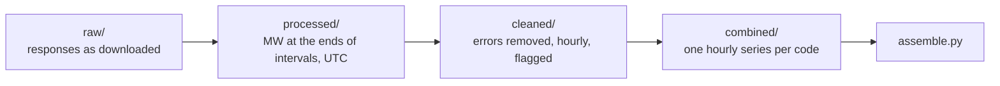

# Electricity demand data

This page explains what happens to the electricity demand of a data source after `retrieve.py` downloads it, until `assemble.py` reads one hourly series per country or subdivision. Read it to understand the files in `data/electricity_demand/`, why some values or hours are missing, and how to review the flags.

## The four stages

The electricity demand goes through four stages. Each stage has its own folder in `data/electricity_demand/` (or in the folder named by `DEMANDCAST_DATA_FOLDER`).



| Stage | Folder | Files | What it holds |
|---|---|---|---|
| Raw | `raw/<data source>/` | `files/`, `manifest.json` | The responses of the data source's website, with every version kept. |
| Processed | `processed/` | `<code>_<data source>.parquet` | The demand of one data source for one country or subdivision, in MW, at the resolution of the source. |
| Cleaned | `cleaned/` | `<code>_<data source>.parquet`, `..._removed.parquet`, `..._flags.parquet` | The processed demand without impossible values, averaged to hours, with the removed values and the flags. |
| Combined | `combined/` | `<code>.parquet`, `<code>_sources.parquet`, `<code>_flags.parquet` | One hourly series per [entity](glossary.md#entity), joined from all its data sources. |

`<code>` is the ISO alpha-3 code of a country (`FRA`) or the code of a subdivision (`USA_CAL`). `<data source>` is the name of the data source's module, such as `entsoe`.

For each country or subdivision, `retrieve.py` runs these steps in order:

1. Download the requests (or replay the raw data with `offline: true`).
2. Process all the versions into the processed file.
3. Clean the processed data and save the removed values.
4. Flag the cleaned data.
5. Combine the cleaned data of all the data sources of the code, and flag the combined series.

If a data source has no data for a code, nothing is saved for it, and the files of earlier retrievals stay as they are.

## Raw data

The raw folder keeps each response once, under its checksum, in `files/`. `manifest.json` lists the requests of each code and their versions. A version is a set of responses that a request got, with the dates of the first and last retrievals that downloaded it. The [retrieval guide](../guides/retrieve.md) explains versions, `offline`, `latest_requests` and manual downloads.

## Processed data

Processing turns the responses into one table per data source and code.

1. Each version of each request is read again from its responses. The module of the data source returns the demand in MW, with time-zone-aware times at the end of each interval.
2. The times are converted to UTC and stored without time zone.
3. Missing times, missing values, values of exactly zero and duplicated times are dropped. For a duplicated time, the first value is kept. Negative values stay until the cleaning.
4. The versions of a request are merged: the newest version gives the values, and older versions fill only the times that the newest one no longer has. So data that a source removes later is kept.
5. Where several requests give the same time, the value of the most recently retrieved version wins.
6. Only the values within the dates of the entity in the data source's YAML file are kept. A value is kept if its interval ends after local midnight at the start of `start_date`, and no later than local midnight at the end of `end_date` (no end limit for `today`). So a country can keep only the dates without the data of its subdivisions.

An older version whose values a new download repeats unchanged is removed from the raw data, since it adds nothing.

| Column | Meaning | Unit |
|---|---|---|
| `Time (UTC)` (index) | End of the interval of the value | UTC, no time zone |
| `Load (MW)` | Average demand over the interval | MW |
| `Retrieved` | When the version that gives this value was first retrieved, such as `2026-10-19T13:09:10Z` | UTC text |

## Gross and net demand

DemandCast models the [gross demand](glossary.md#gross-demand): all the electricity consumed, whatever generation supplies it. Many system operators publish the demand on their own network instead. That demand leaves out the part supplied by [embedded generation](glossary.md#embedded-generation): rooftop solar and other generators connected to the distribution networks. Demand without it is [net demand](glossary.md#net-demand).

As rooftop solar grows, the net demand at midday falls year after year. A model trained on it would learn a profile that depends on the installed solar, not on the consumers. Energy system models that represent this generation explicitly would also count it twice. See [issue #280](https://github.com/open-energy-transition/demandcast/issues/280).

DemandCast therefore:

- records what each data source counts, period by period, in the `definition` of its YAML file;
- adds the embedded generation where the source or its system operator publishes an estimate of it: the embedded wind and solar of NESO, the licence-exempt generation of EPIAS until 2020-12-29, the rooftop solar of AEMO in the NEM and the WEM, and the solar behind the meters of ISO New England (their `definition` then says `added`);
- flags a midday dip in the cleaned demand, which a review can mark as net demand;
- ranks the gross demand first when it combines the data sources of a code.

The annual electricity demand per capita, which scales the forecasts, comes from Ember first. Ember's demand is the electricity supplied, including the consumers' own generation (see [inputs](inputs.md)).

### The `definition` of a data source

`definition` is a list of periods. Each period applies from its `start_date` until the next one starts. A date before the first period takes the first period. `utils.data_sources.get_definition(data_source, date)` returns the period of a date.

| Field | Meaning |
|---|---|
| `start_date` | First local day of the period. Periods must be in order. |
| `quantity` | What the source calls its demand, such as "demand of the balancing authority (EIA-930)". |
| `embedded_generation` | Whether the demand counts the embedded generation. |
| `network_losses` | Whether it counts the losses of the networks. |
| `storage_charging` | Whether it counts the charging of storage, such as pumped hydro or batteries. |
| `power_plant_use` | Whether it counts the electricity that power plants use themselves. |
| `note` | The reasons, in words. |

Each of the four parts takes one of these values:

| Value | Meaning |
|---|---|
| `included` | The source counts it. |
| `added` | DemandCast adds an estimate of it. |
| `partial` | The source counts only part of it, such as the rooftop solar fed into the network but not the solar that consumers use themselves (the Japanese transmission operators). |
| `excluded` | The demand leaves it out. |
| `unknown` | Nobody knows. |

For example, the total demand of AEMO for the NEM leaves out rooftop solar until 2016 (`excluded`), and has AEMO's estimate added from 2017 (`added`). The definition is what the provider says. A midday flag is statistical evidence, which a review compares with the definition.

Two more fields of the YAML file matter for the combination:

- `compiled: true` marks a source that republishes the data of system operators, such as the EIA, the CCEI and ENTSO-E. `republishes` lists the compiled sources that a source copies in turn, such as the IEA, which republishes the EIA.
- `same_area: false` on an entity marks data that covers only part of the area of the code's shape.

The [data sources reference](../reference/data-sources.md) lists every source.

## Cleaning

The cleaning removes values that are very unlikely to be the demand of a system, then averages the rest to hours. The rules look for what errors usually look like, not for the errors of particular sources. A removed value can still be real, such as a rounded reading.

### How values are read

- **Interval.** Each value is the average demand of its interval. The interval is the time since the value before, but at most the [resolution](glossary.md#resolution). So a value after a gap does not cover the gap.
- **Resolution.** The resolution of a value is the median time between the 25 values around it, because some sources change resolution (for example, the NEM went from 30 to 5 minutes in October 2021).
- **No bridging.** Intervals are computed once, before any value is removed. A value follows the one before it only if the time between them equals its interval. The rules that look at runs of values never bridge a gap, whether the source misses the values or an earlier rule removed them.
- **Day.** The day of a value is the [local day](glossary.md#local-day) of the start of its interval. So the value at midnight belongs to the day that it ends.

### Cleaning rules

The rules run in this order. Each rule looks only at the values that earlier rules kept, and each removed value records the first rule that removed it.

| Rule | What it catches | Threshold | Why |
|---|---|---|---|
| `future` | Values whose interval ends after the time of the cleaning | End time later than now (UTC) | Future times cannot have data. |
| `non_positive` | Zero or negative values | ≤ 0 MW | The demand of a whole system is always positive. |
| `implausible` | Values far above the values around them, such as unit errors | > 3 × the median of the values within the 30 days centred on the value | Demand never triples within a month. |
| `frozen` | The same value repeated without a gap | Run lasting ≥ 6 hours (sum of the intervals) | A stuck reading or filled data, not real demand. |
| `copied_day` | Local days whose values repeat an earlier day at the same times of day | Equal after rounding to 0.01 MW; only days with ≥ 12 values | Copied data. The rounding catches copies converted between units. |
| `spike` | A short run that leaves the level of the values just before and after it, and comes back | See below | Real demand rarely jumps and returns within 30 minutes. |
| `level_drop` | Long runs of days far below the usual level | ≥ 14 days below 0.5 × the level | A part of the system left out of the data. |
| `low_coverage` | Hours whose remaining values cover too little of the hour | < 30 minutes covered | The average of a few minutes does not represent the hour. |

**Copied days.** The days are built twice: once from the starts of the intervals and once from their ends, since a source copies whole days by whichever times it uses (Taipower copied 2017-09-24 by the ends). The first occurrence of a day is kept; later copies are removed.

**Spikes.** A run is a spike when all of these hold:

1. The values before and after the run are at the same level: they differ by less than half the change below (10% or 25%) of their mean.
2. Every value of the run is above both neighbours by more than the change, or below both by more than the change. The change is 20% when the resolution is under 30 minutes, and 50% from 30 minutes, because the demand of a small system can change by 20% within an hour.
3. The run, and the values before and after it, follow each other without gaps.
4. The run lasts at most 30 minutes. At a resolution of 30 minutes or more, only a single value can be a spike. At 15 minutes, up to 2 values; at 5 minutes, up to 6.

**Level drops.** For each local day, the cleaning computes the mean demand, weighted by the intervals. A day whose values cover less than half of it has no mean.

1. The level of a day is the median, over the years 2 and 1 before and 1 and 2 after, of the median daily mean of the 31 days around the same date in that year. A year needs at least 15 of those 31 days. So a drop needs data in at least one neighbouring year.
2. A day is low if its mean is below half its level.
3. A run of low days continues over gaps of up to 3 days without a mean, but stops at a longer gap or at a day that is not low.
4. A run with at least 14 low days is removed (only its days with a mean count).
5. The level is computed again without the days found, and step 2 to 4 repeat, so that the error of one year does not hide that of another.

Days from 2020-03-15 to 2020-06-30 are never low, because the COVID-19 lockdowns really halved the demand of some places. Real drops found this way include Albania from 2022-12-11 to 2023-12-04 and the Netherlands from 2014-10-20 to 2014-12-19, at about a quarter of their level.

### Resampling to hours

The values that are left are averaged into hours. Each hour is labelled by its end, in UTC.

1. Each value counts for the part of its interval that falls inside the hour. An interval that crosses the start of an hour is shared between the two hours. For example, the hours of India end on the half hour in UTC, so each one is split between two UTC hours.
2. The average of an hour is its energy (MW × time) divided by the time covered. This keeps the energy of the values.
3. The hour is kept only if its values cover at least half of it (30 minutes). Otherwise it is listed as `low_coverage`.

For example, a 15-minute source missing one value in an hour gives the average of its three other values, which cover 45 minutes.

### Cleaned files

`<code>_<data source>.parquet` has the hourly demand:

| Column | Meaning | Unit |
|---|---|---|
| `Time (UTC)` (index) | End of the hour | UTC |
| `Load (MW)` | Average demand of the hour | MW |

`<code>_<data source>_removed.parquet` lists the removed values as periods. Removed times that are no further apart than the coarsest resolution of the source form one period.

| Column | Meaning |
|---|---|
| `start` | First removed time of the period (end of its interval, UTC) |
| `end` | Last removed time of the period (UTC) |
| `rule` | The rule that removed them |
| `values` | The number of values removed; the number of hours for `low_coverage` |

`low_coverage` lists only hours that had some values. Hours with no value at all are simply missing.

## Flags and reviews

The cleaning also marks suspicious periods with **flags**, which a person reviews. Flags never remove values, but a review can keep hours out of the combination or out of the training. See [Quality flags and reviews](flags.md).

## Combination

The combination joins the cleaned demand of all the data sources of a code into one hourly series. It runs after the cleaning of each code. The ranking is of whole sources, not hour by hour, so that the series does not switch between sources at each change of their definitions.

### Ranking the data sources

Before ranking, the hours that a review finds to be errors (`source_error` or `reading_error`) are taken out of their source. The sources are then sorted by these criteria, in order:

1. **Area.** Sources whose data covers the whole area of the code's shape come before those with `same_area: false`.
2. **Compilation level.** Data that a system operator publishes itself (level 0) comes before data that a source republishes (`compiled: true`, level 1), which comes before data republished from such sources (`republishes`, one level more than the highest source it republishes). A copy cannot count more than the original, even when its definition is less known, as for the CCEI, whose definition differs by province.
3. **Definition.** The mean rank of the definition of the source's hours, from its `embedded_generation`: 0 for `included` or `added`, 1 for `partial`, 2 for `unknown`, 3 for `excluded`. Hours in periods reviewed as `net_demand` count as at least 3.
4. **Length.** More hours come first.

Sources that tie on all four keep the alphabetical order of their names.

### Filling the hours

1. The best source gives all its hours.
2. Each next source is compared with the hours combined so far, over their common hours. For each common hour, the ratio is the source's value divided by the combined value.
3. The source can fill only the hours before the first combined hour, after the last one, or inside gaps of at least a day (where the combined hours around the gap are more than 24 hours apart). Shorter gaps stay empty, so that the series does not switch sources at each missing hour.
4. Whether it fills them depends on the ratio checks below. A source that fails gives none of its hours, even those outside the range of the others.
5. Last, the hours of reviewed errors of each source fill whatever hours are still empty under the rule of step 3, without a ratio check.

| Common hours | The source fills if | Otherwise |
|---|---|---|
| 7 days (168 hours) or more | The median ratio is within 2% of 1, and 90% of the ratios (5th to 95th percentile) are within 5% of 1 | It gives a different quantity and fills nothing. |
| 1 to 7 days (24 to 167 hours) | The median ratio is within 10% of 1 (filled as unverified) | It gives a different quantity, such as twice the demand, and fills nothing. |
| Less than a day | Always (unverified) | — |

With less than 7 days of common hours, such as for a source that starts after the other ends, the ratios cannot show whether the source gives the same quantity. It fills as unverified. A step between the sources then shows in the `annual_change` flags of the combined series.

### Eligibility for training

The combined series keeps all its hours, and marks which ones can train the models.

| Exclusion | Hours | Why |
|---|---|---|
| (empty) | All other hours; `Eligible` is true | — |
| `reviewed error` | Hours of a reviewed error of their source or of the combined series | The training data has no error that a review has found. |
| `net demand` | Hours in periods reviewed as `net_demand` | Their profile leaves out the demand that embedded generation supplies, and would teach the models the wrong shape. |

Hours whose definition is `excluded`, `unknown` or `partial` stay eligible. Most system operators measure the demand on their transmission network, and the embedded generation of most countries is too small to change the shape of the demand. Where it does, the midday dip flag finds it as it grows, and its review makes the season net demand. Generation that a series already leaves out in its first years, as in California, is known only from the declared definition. The `Definition` column records it for each hour.

`assemble.py` leaves out the hours that are not eligible before it checks the coverage of each year, and logs how many hours of each code it left out (see the [assembly guide](../guides/assemble.md)).

### Combined files

`<code>.parquet` is the series that `assemble.py` reads:

| Column | Meaning | Unit |
|---|---|---|
| `Time (UTC)` (index) | End of the hour | UTC |
| `Load (MW)` | Average demand of the hour | MW |
| `Source` | The data source of the hour | — |
| `Definition` | What the demand of the hour counts of the embedded generation (`included`, `added`, `partial`, `excluded` or `unknown`), from its source's definition on the local day | — |
| `Eligible` | Whether the hour can be used for training | true/false |
| `Exclusion` | Why not: `reviewed error`, `net demand`, or empty | — |

`<code>_sources.parquet` lists what happened to each source:

| Column | Meaning |
|---|---|
| `data_source` | The data source |
| `rank` | Its position, from 1 for the best; the reviewed errors come after all the sources |
| `hours` | Its number of hours (without its reviewed errors) |
| `first`, `last` | Its first and last hour (UTC) |
| `common_hours` | Its hours in common with the hours combined before it |
| `median_ratio` | The median ratio over the common hours |
| `low_ratio`, `high_ratio` | The 5th and 95th percentiles of the ratio |
| `used_hours` | The hours that it gives to the combined series |
| `decision` | `best`, `fills`, `fills unverified`, `not needed` (nothing left to fill), `different quantity` or `reviewed errors` |

`<code>_flags.parquet` holds the flags of the combined series, with the columns of the [flag files](flags.md#flag-files).

### Examples

These examples follow from the YAML files and the ratio checks above.

- **CCEI extends Hydro-Québec.** For the integrated network of Québec (`CAN_QC-INTEGRATED`), Hydro-Québec publishes its own data from 2019-01-01 to 2025-12-31 (level 0). The CCEI republishes it from 2021-10-05 onwards (`compiled: true`, level 1), and the IEA republishes the CCEI (level 2). Hydro-Québec is the best source. The CCEI matches it within the 2% and 5% limits over years of common hours, so it `fills` the hours from 2026.
- **EIA does not fill ISO New England.** For New England (`USA_NE`), ISO New England is level 0 and has the solar behind the meters `added`. The EIA is level 1 and its definition has it `excluded`. Their median ratio is close to 1, but the EIA's demand is much lower in the hours with solar: the 5th percentile of the ratio is far below 0.95. The EIA gets `different quantity` and fills nothing. The IEA, which republishes the EIA, gets the same decision, and fills nothing even before ISO New England's data starts.

## When the combination runs again

A combined series records a [fingerprint](glossary.md#fingerprint) of what decided it, in the metadata of its Parquet file. The fingerprint is a SHA-256 checksum of:

- the code files `combining.py`, `electricity_demand.py`, `flags.py` and `reviews.py` in `demandcast/cleaning/` (any change, even to a comment, changes it);
- `demandcast/checks/reviewed_flags.yaml`;
- the YAML files of the data sources of the code;
- the flag files of the cleaned data of those sources.

A combined series is current if it exists, has the `Eligible` column, has the current fingerprint, and is not older than the cleaned file of any of its sources. When you assemble training data, `assemble.py` combines every series that is not current again from the cleaned data, such as one made before a change of a review, or one copied from a bucket. It stops with an error if a combined series still has no `Eligible` column.

!!! warning
    Recombining reads the existing cleaned data and its flags. After a change to the cleaning rules (`electricity_demand.py`) or to the flags (`flags.py`), the combination runs again, but the cleaned data and the flags of the sources stay as the old code made them. Process the raw data again with `offline: true` in `retrieve.py` to apply the new rules.

To combine all the codes again without assembling, run from the `demandcast/` folder:

```bash
uv run python -c "import logging, cleaning.combining; logging.basicConfig(level=logging.INFO); cleaning.combining.combine_all_data()"
```

`cleaning.combining.combine_all_data()` combines every code of every data source that has cleaned data, and returns the list of codes it combined.
