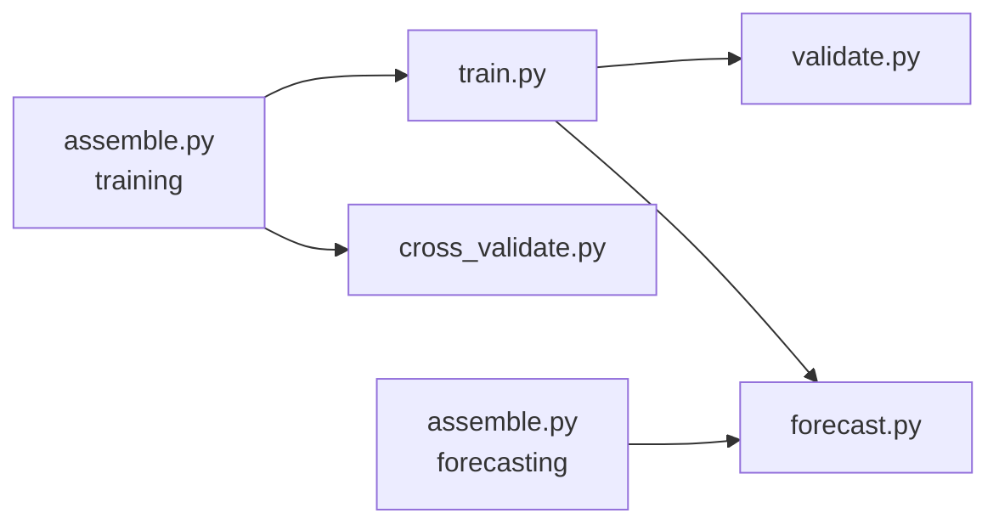

# Models

This page explains how DemandCast turns weather and socio-economic data into hourly electricity demand: what the models learn, from which inputs, how the data is split, and how the errors are measured. Read it before you train, validate or trust a forecast.

## Overview

A model learns the hourly shape of the electricity demand of a country or subdivision (an *entity*) from its calendar, its temperature and its wealth. A forecast then scales that shape to the annual demand of the entity.

1. `assemble.py` merges the inputs into one table, one row per hour and entity (see [Assemble a dataset](../guides/assemble.md)).
2. `train.py` trains a model on some years and keeps the latest years apart; `validate.py` scores it on those years (see [Train and validate](../guides/train-validate.md)).
3. `cross_validate.py` scores the model on entities that it never saw (see [Cross-validate](../guides/cross-validate.md)).
4. `forecast.py` predicts the hourly demand in MW (see [Forecast](../guides/forecast.md)).



## The target

The *target* is the value a model learns to predict. In the assembled data it is the column `Load (fraction of annual total)`: the share of the year's demand that falls in each hour.

```text
fraction = Load (MW) × hours with data / (hours in the year × sum of Load (MW) over the hours with data)
```

The year is the *local year*: the calendar year in the entity's own time zone. It has 8760 hours, or 8784 in a leap year. The sum covers the hours of the year that the dataset keeps, and the factor `hours with data / hours in the year` corrects for the missing ones. A fraction lets a small and a large country share one model, because both have values of the same size.

### What the models learn: the load relative to the annual mean

An average hour has a fraction of about 1/8760, which is too small for the models: the gain of an XGBoost split grows with the square of the target, so almost no split would pass its minimum gain. Before training, DemandCast multiplies the fraction by the hours in its local year:

```text
load relative to the annual mean = fraction × hours in the year
```

This value has no unit. An average hour is 1.0, and 1.2 is an hour with 20% more demand than average. Every model is trained on it, and the manifest of each model records this transformation. The assembled data keeps the fraction.

### From the predictions to MW

A forecast needs the annual demand of each entity and year, in kWh. It is the product of the *scaling variables* of `ml_config.yaml`: the annual electricity demand per capita (kWh) times the population.

1. Negative predictions become zero.
2. In each *complete* year of an entity (one with a row for every hour), the predictions are divided by their mean, so that their mean is exactly 1. Their MW then sum to the annual demand.
3. A year without all its hours, or whose predictions are all zero, is not scaled. The log lists these years.
4. Each prediction is divided by the hours in its local year (back to a fraction), multiplied by the annual demand in kWh, and divided by 1000:

```text
Forecast load (MW) = prediction / hours in the year × annual demand per capita (kWh) × population / 1000
```

The manifest of the forecasts gives the status of each year: `scaled`, `incomplete` or `zero`. A prediction that is not a finite number, an hour with two predictions, or an annual demand that is not a positive number stops the forecast.

The validation and the cross-validation score the predictions as the model gives them, before this scaling. The validation also gives the error of the scaled predictions (see [Metrics](#metrics)).

## Input features

A *feature* is an input column of the model. The default features of `ml_config.yaml` come from the temperature, the indicators and the calendar (see [Inputs](inputs.md) for their sources).

| Feature | Meaning | Unit | Categorical |
|---|---|---|---|
| `Local hour of the day` | The hour of the start of the hour in local time, 0 to 23 | – | Yes |
| `Local weekend indicator` | 1 if the hour starts on a Saturday or Sunday in local time, else 0 | – | Yes |
| `Local holiday indicator` | 1 if the hour starts on a public holiday of the entity in local time, else 0 | – | Yes |
| `Local month of the year` | The month of the start of the hour in local time, 1 to 12 | – | Yes |
| `Temperature - Top 1 (K)` | The mean temperature of the hour in the most populous grid cell of the entity | K | No |
| `Temperature - Top 3 (K)` | The same, averaged over the three most populous grid cells | K | No |
| `Monthly average temperature - Top 1 (K)` | The mean temperature of the month of the hour, in the same local year, in the most populous cell | K | No |
| `Monthly average temperature rank - Top 1` | The rank of that month by its mean temperature in its local year: 1 is the warmest month, 12 the coldest | – | Yes |
| `Annual average temperature - Top 1 (K)` | The mean temperature of the local year in the most populous cell | K | No |
| `5 percentile temperature - Top 1 (K)` | The temperature below which 5% of the hours of the local year fall, in the most populous cell | K | No |
| `95 percentile temperature - Top 1 (K)` | The temperature below which 95% of the hours of the local year fall, in the most populous cell | K | No |
| `GDP PPP per capita (2021 international $)` | The gross domestic product per person at purchasing power parity, in 2021 international dollars, of the local year | $ | No |
| `Annual electricity demand per capita (kWh)` | The electricity demand per person of the local year | kWh | No |

The calendar features describe the *start* of each hour in local time. So the hour from 23:00 to midnight on a Friday is on a Friday, and the hour before midnight on 1 January belongs to the year before. `assemble.py` adds the holiday indicator from the `holidays` package: the holidays of the country, plus those of the state or province if it is an official ISO 3166-2 subdivision that the package knows. A subdivision defined by a system operator, such as New England (`USA_NE`), has only the holidays of its country, and a country that the package does not know has none (the log says so). India and its states count only the six holidays on which their demand drops: Republic Day, Independence Day, the birthday of Mahatma Gandhi, Holi, Diwali and Dussehra.

`Population` is in the assembled data but is not a feature: it is a scaling variable, used only to convert the predictions to MW.

### Categorical and continuous features

A *continuous* feature is a number whose distances mean something: 20 °C is halfway between 10 °C and 30 °C. A *categorical* feature is a number used as a label: February is not "twice" January. The features listed in `categorical_features` are converted to integers and then to categories. XGBoost handles categories natively. The LSTM encodes the hour and the month as a sine and a cosine, and takes the other categories as plain numbers (see [LSTM](#lstm)).

## Splitting the data in time

Random splits would let a model see the hours right before and after the ones it is tested on, which makes its errors look too good. DemandCast instead splits each entity by its local years, in `train.py` and `validate.py`:

| Set | What it holds | When |
|---|---|---|
| Testing set | The latest local year of each entity | `reserve_testing_set: true` |
| Validation set | The latest year before the testing year, or the latest year if there is no testing set | `use_validation_set: true` |
| Training set | All the other years | Always |

The years are those that the entity has, so a missing year is skipped. With data for 2019, 2021 and 2023, the testing set is 2023, the validation set 2021 and the training set 2019. No training year of an entity comes after its held-out years.

An entity with no more years than the held-out sets gives its years to the testing set first, then to the validation set, and none to training. The log warns about it. Such an entity is scored, but the model never saw it.

The validation set has two uses. XGBoost uses it to stop adding trees early, if `early_stopping_rounds` is set. Otherwise, and for the LSTM, its year is only left out of the training.

## Related entities

Two entities are *related* when they cover some of the same people: a country and its subdivisions, a grid and the state that it supplies, or two periods of a grid whose area grew. If a model trains on one and is scored on the other, it sees the demand of the same people at the same hours, so the score is too good.

Two entities are related when the people of their shared area are at least 10% of the people of either of them. `check.py` (with `check: related_entities`) computes these shares for each pair of entities of the same country with data, from the gridded population of 2020. It writes them to `demandcast/checks/related_entities.csv` (columns `Entity code`, `Other code`, `Share of entity`, `Share of other`, `Related`), and the codes it considered to `demandcast/checks/related_entities_codes.txt`. The file `demandcast/config/related_entities.yaml` lists the exceptions: pairs that are `related`, or `unrelated`, whatever their shares. See [Run checks](../guides/check.md) for how to run the check.

!!! warning
    Run the check again after you add an entity or change a shape. The tests fail when a data source has a code missing from `related_entities_codes.txt`. An entity missing from `related_entities.csv` has no related entities, so the splits do not protect it.

### How related entities change the splits

Two rules apply to the temporal splits:

- **Superseded entities.** An entity is *superseded* when a related entity has data only after its own data ends, such as the North of Brazil of 2000 (`BRA_N-2000`), followed by later periods of the same grid. A superseded entity has no held-out year: all its years are for training, and it is not scored.
- **Held-out years.** The years held out of an entity are also left out of the training set of its related entities. They go to no set, unless they are held out of the related entity itself.

Example: France (`FRA`) has 2015–2024 and a French region has 2015–2020. The testing set holds France 2024 and the region 2020. The region's 2024 does not exist, and France's 2020 is left out of training.

## Cross-validation

The temporal split tells how well a model predicts a new year of an entity it knows. *Cross-validation* tells how well it predicts an entity it has never seen, which is what a forecast for an entity without data needs.

DemandCast uses *leave-one-group-out* cross-validation. Each *fold* holds out one group: it trains a model on all the other entities, then scores that model on the group. It repeats this for every group. The `holdout` option chooses the group:

| `holdout` | Each fold holds out | It also leaves out of training | What it measures |
|---|---|---|---|
| `entity` (default) | One entity | The entities related to it, which it does not score | The error on an entity whose country may have data of its other subdivisions |
| `country` | A country with all its subdivisions (all codes that start with its ISO code) | The entities related to any of them | The error on a country of which the model has seen no part |

With `holdout: entity`, a fold that holds out a province of Argentina leaves out Argentina too, but still trains on the other provinces. A cross-validation uses all the years of every entity: there is no temporal split.

## Algorithms

Set the algorithm with `algorithm` in `ml_config.yaml`. The choice is `XGBoost` (the default) or `LSTM`, in any case.

### XGBoost

[XGBoost](https://xgboost.readthedocs.io/en/stable/) (eXtreme Gradient Boosting) builds many small decision trees, each one correcting the errors of the trees before it. Studies of load forecasting use gradient boosting with weather and economic inputs (for example [Mattsson et al., 2021](https://doi.org/10.1016/j.esr.2020.100606)), which is the approach of DemandCast. XGBoost is fast to train and to predict, handles categorical and continuous features natively, and has built-in regularization against overfitting. Each row is an independent hour: the calendar features give it its context.

Its settings are in `xgboost_config.yaml` (see [the XGBoost settings](../guides/train-validate.md#xgboost_configyaml)). Hyperparameters that you leave empty keep the defaults of XGBoost, such as 100 trees. The model is saved as a JSON file.

### LSTM

A *Long Short-Term Memory* network (LSTM) is a neural network that reads a sequence of hours in order and keeps a memory of them. Demand at an hour depends on the hours just before it (morning ramp, evening peak, night trough), and studies find that LSTMs capture such daily and weekly patterns well (for example [Ul Rehman and Iqbal, 2025](https://doi.org/10.1186/s42162-025-00587-5)). DemandCast offers it as an optional alternative to compare with XGBoost under the same splits and metrics.

How it works:

- The network is PyTorch's `nn.LSTM` (one or more stacked layers) followed by one linear layer that gives one number per hour.
- Each prediction reads a *window* of `n_timesteps` rows: the row itself and the rows before it of the same entity. The windows hold features only, never the demand of earlier hours.
- A window never crosses a change of entity or a gap: a run of rows restarts at each row that is not one hour after the row before it, such as after a missing hour or year. The missing start of a window is filled with zeros.
- Each step of a window has a padding indicator, 1 for a real row and 0 for padding, because 0 is also the mean value of each standardized feature.
- `Local hour of the day` and `Local month of the year` become the sine and cosine of their angle in the day and in the year, so 23:00 is next to midnight and December next to January.
- Each feature is standardized with its mean and standard deviation in the training rows, which are saved with the model and recorded in its manifest. Otherwise features of very different sizes, such as GDP and temperature, would saturate the network.
- The windows are built batch by batch, so the windows of all the rows are never in memory at once.

Limits:

- The first `n_timesteps − 1` rows of each run have a shorter context, padded with zeros.
- The weekend and holiday indicators and the monthly temperature rank are taken as plain numbers, standardized like the others, with no embedding.
- The LSTM ignores the validation set and has no early stopping.
- It trains on the CPU only, with the CPU build of PyTorch.
- It needs the optional `lstm` extra: install it with `uv sync --extra lstm`. XGBoost works without it.

Its settings are in `lstm_config.yaml` (see [the LSTM settings](../guides/train-validate.md#lstm_configyaml)). The model is saved as a `.pt` file.

## Metrics

The errors are computed on the target that the models learn, the load relative to the annual mean. So they measure the error of the hourly *shape*, not of the annual demand, and each year of an entity counts the same, whatever its demand. Both metrics are fractions: 0.07 means 7%.

For the hours `t` of an entity in a set, with actual value `y_t` and prediction `ŷ_t`:

```text
MAPE = mean over t of |ŷ_t − y_t| / |y_t|
WAPE = sum over t of |ŷ_t − y_t| / sum over t of |y_t|
```

The *mean absolute percentage error* (MAPE) divides the error of each hour by its own actual value. A few hours close to zero can dominate it, such as the net demand of North Macedonia at midday in summer. The *weighted absolute percentage error* (WAPE) divides the total error by the total actual value, so such hours cannot dominate it.

`validate.py` gives, for each entity and each set (training, validation, testing):

| Column | Meaning |
|---|---|
| `<Set> MAPE`, `<Set> WAPE` | The MAPE and WAPE of the predictions as the model gives them |
| `<Set> MAPE of the complete years scaled to their annual totals` | The MAPE of the predictions scaled as `forecast.py` scales them, on the complete years only; empty for an entity without a complete year |
| `<Set> absolute error (MWh)`, `<Set> demand (MWh)` | The sum of the absolute errors and of the demand of the entity, in MWh |

A constant prediction of 1.2 for a target of 1 has a MAPE of 20%, but of 0% once scaled.

The error of an hour in MW is its prediction times the mean load of its local year, minus its actual load. Both then have the same annual demand, and differ only by the error of the shape. Summing these errors over several entities gives a WAPE in which each hour counts by its demand in MW (the *pooled WAPE*, see below).

`cross_validate.py` gives, for each held-out entity, its `Testing MAPE` and `Testing WAPE` and its errors in MWh, and the `Training MAPE` and `Training WAPE` of its fold. The training errors of a fold are computed over all its training rows together, not per entity.

## Reporting by group

The results describe each scored entity, so that they tell *where* a model fails, not only how much. These columns follow the errors in the results of `validate.py` and `cross_validate.py`:

| Column | Meaning |
|---|---|
| `Seen in training`, `Training years` | Whether the model saw other years of the entity in training, and how many. Only in a validation: a cross-validation never sees the entities it scores |
| `Scored years`, `Scored hours` | The local years and hours on which the entity is scored |
| `Mean load (MW)` | The mean load of the scored hours |
| `Size class` | `Small` (mean load below 300 MW), `Medium` (below 5000 MW) or `Large` |
| `Continent` | The continent of the entity's country |
| `Data source` | The data source of most of the scored hours |
| `Embedded generation` | What the demand of most of the scored hours counts of the generation inside the grid, such as rooftop solar (see [Electricity demand](electricity-demand.md)) |

The data source and embedded generation come from the `_provenance.csv` file that the assembly writes, checked against the manifest of the dataset. So later retrievals or reviews do not change them.

The errors are then summarized by group, in a `summary_<time>.csv` file next to the results and in the log. The groups are all the entities, and each value of `Seen in training`, `Size class`, `Continent` and `Embedded generation`. Entities with an unknown value are left out of that column's groups.

| Column | Meaning |
|---|---|
| `Group`, `Value` | The grouping column and its value (`All`, `All` for all entities) |
| `Codes` | The number of entities in the group |
| `Median WAPE` | The WAPE of a typical entity of the group |
| `Pooled WAPE` | The sum of the absolute errors of the group in MWh over the sum of its demand in MWh |
| `Median MAPE` | The MAPE of a typical entity of the group |

The median tells how well a typical entity is modelled, and the pooled WAPE how well the demand of the group is. Example: two years of 100 MW and 1000 MW, the first predicted at twice its shape and the second exactly. Their median WAPE is 50%, but their pooled WAPE is 9.1%, because the large year counts ten times more.

## Manifests

Each assembled dataset, trained model and set of results has a *manifest* next to it: a JSON file with the same name and the extension `.manifest.json`. It tells what the file is and how it was made, so a model, its data and its results can be checked to belong together.

Every manifest records:

- its kind (`dataset`, `model` or `results`) and its version;
- the SHA-256 checksum of the file, and of each of its formats (such as the Parquet and CSV files of the same results);
- the time it was written (UTC);
- the version of the code: the git commit (with `+changes` if the code had uncommitted changes) and the checksum of `uv.lock`.

Paths to data are relative to the data folder, so they stay valid in a copy of it.

| Kind | It also records |
|---|---|
| Assembled dataset | Its purpose (`training` or `forecasting`); the settings of `assemble.py`; its columns and their types; its number of rows; its entities; for each input, the number of files read and one checksum of their paths and contents; for training data, the name and checksum of its `_provenance.csv` |
| Model | Its algorithm; its dataset and checksum; the settings of `ml_config.yaml` and of the model; its features in order with their types; its target and the transformation of the target; the statistics of its standardization (LSTM only); the entities and local years of each of its sets |
| Results | The case (`validation`, `cross_validation` or `forecasts`); the name and checksum of the model and of the dataset; the columns. For errors: the metric (MAPE and WAPE of the load relative to the annual mean, lower is better), and the checksums of the summary and predictions files. For a cross-validation: also the `holdout`, the settings of `ml_config.yaml` and of the model, the entities each fold scores and leaves out, and the checksum of the archive of the fold models and of each model in it. For forecasts: the unit (MW) and the scaling status of each year |

### When a script refuses a file

The scripts check a file against its manifest before they use it. They stop with an error when:

| Script | It stops if |
|---|---|
| Any script reading a file with a manifest | The manifest is of another kind, does not name the file, records another checksum (the file was changed or replaced), or has a newer manifest version than the code |
| `train.py`, `validate.py`, `cross_validate.py`, `forecast.py` | The assembled data was assembled for the other purpose (training data given to `forecast.py`, or the reverse) |
| `validate.py` | The model was trained without a testing set; the data of the training is missing (it does not fall back to other data); the data, the target or its transformation, the features (in order), the categorical features, the scaling variables or the sets differ from those of the training |
| `forecast.py` | The target or its transformation, the features (in order), the categorical features or the scaling variables differ from those of the training |
| `validate.py`, `cross_validate.py` | The `_provenance.csv` of the dataset differs from the one its manifest records |

A file without a manifest is used with a warning in the log, because its origin cannot be checked. A model without a manifest is used without these checks; `validate.py` then needs `used_validation_set`.

## Benchmark

The benchmark compares the algorithms under the same conditions on a small dataset: Denmark (`DNK`), Austria (`AUT`) and Portugal (`PRT`), from 2021 to 2023. The folder `demandcast/benchmark/` holds the settings of each step and `run.py`, which runs the steps in order and stops at the first that fails:

| Step | Script | Settings file |
|---|---|---|
| 1 | `retrieve.py` | `retrieve_electricity_demand.yaml` (ENTSO-E) |
| 2 | `retrieve.py` | `retrieve_annual_electricity_demand_per_capita.yaml` |
| 3 | `retrieve.py` | `retrieve_population.yaml` |
| 4 | `retrieve.py` | `retrieve_gdp_ppp_per_capita.yaml` |
| 5 | `retrieve.py` | `retrieve_temperature.yaml` (2021–2023) |
| 6 | `assemble.py` | `assemble.yaml` (training, 2021–2023) |

The countries are listed in `benchmark/codes.yaml`.

```bash
cd demandcast
uv run python -m benchmark.run                 # all six steps
uv run python -m benchmark.run --from-step 5   # resume from the temperature
```

The progress goes to the terminal and to a `benchmark_<time>.log` file in the logs folder, where each step also writes its own log. The assembled data goes to `data/assembled/`. Then train and validate each algorithm on it with `reserve_testing_set: true`, so that the latest year of each country is the testing set. Use the default settings of each algorithm: for the LSTM, `n_timesteps: 24`, `n_units: 32`, `n_layers: 1` and `epochs: 5`.
