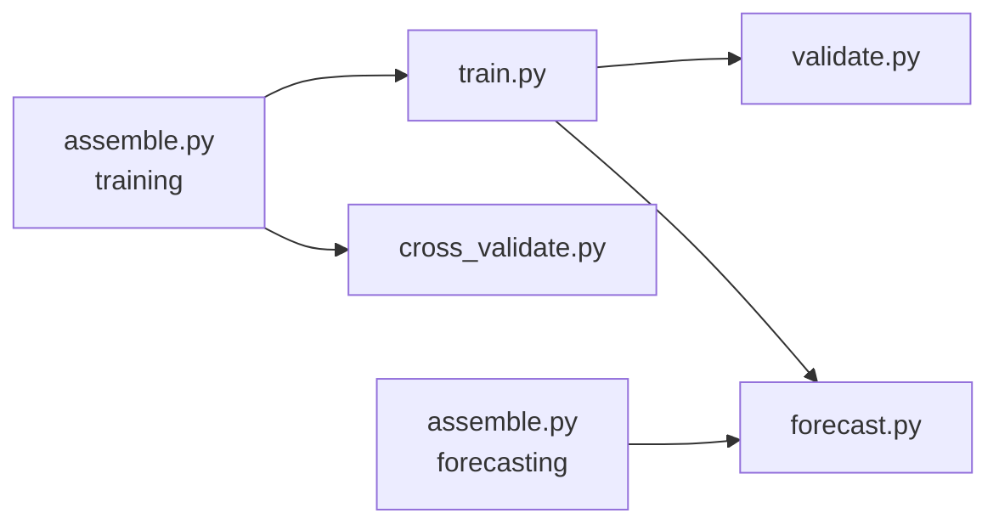

# Models

How DemandCast turns weather and socio-economic data into hourly electricity demand: what the models learn, from which inputs, how the data is split and how errors are measured. Read it before you train, validate or trust a forecast.

## Overview

A model learns the hourly shape of the demand of a country or subdivision (an [entity](glossary.md#entity)) from its calendar, temperature and wealth. A forecast then scales that shape to the annual demand of the entity.

1. `assemble.py` merges the inputs into one table, one row per hour and entity ([Assemble a dataset](../guides/assemble.md)).
2. `train.py` trains a model and keeps the latest years apart; `validate.py` scores it on them ([Train and validate](../guides/train-validate.md)).
3. `cross_validate.py` scores the model on entities it never saw ([Cross-validate](../guides/cross-validate.md)).
4. `forecast.py` predicts the hourly demand in MW ([Forecast](../guides/forecast.md)).



## The target

The *target* is the value a model learns to predict. In the assembled data it is `Load (fraction of annual total)`: the share of the year's demand that falls in each hour.

```text
fraction = Load (MW) × hours with data / (hours in the year × sum of Load (MW) over the hours with data)
```

The year is the [local year](glossary.md#local-day): the calendar year in the entity's time zone, with 8760 hours (8784 in a leap year). The factor `hours with data / hours in the year` corrects for missing hours. A fraction lets a small and a large country share one model.

### What the models learn: the load relative to the annual mean

An average hour has a fraction of about 1/8760. That is too small for XGBoost: the gain of a split grows with the square of the target, so almost no split would pass its minimum gain. So, before training, DemandCast multiplies the fraction by the hours in its local year:

```text
load relative to the annual mean = fraction × hours in the year
```

This value has no unit: an average hour is 1.0, and 1.2 is 20% above average. Every model is trained on it, and its manifest records this transformation. The assembled data keeps the fraction.

### From the predictions to MW

A forecast needs the annual demand (kWh) of each entity and year: the product of the `scaling_variables` of `ml_config.yaml`, the annual electricity demand per capita (kWh) times the population.

1. Negative predictions become zero (the log counts them).
2. In each *complete* year of an entity (a row for every hour), the predictions are divided by their mean, so their mean is 1 and their MW sum to the annual demand.
3. A year without all its hours, or whose predictions are all zero, is not scaled. The log lists these years.
4. Each prediction is converted to MW:

```text
Forecast load (MW) = prediction / hours in the year × annual demand per capita (kWh) × population / 1000
```

The forecast stops if a prediction is not a finite number, an hour of an entity has two rows, or an annual demand is not a positive number. The manifest of the forecasts gives the status of each year (see [Forecast](../guides/forecast.md#annual_totals-in-the-manifest)).

## Input features

A [feature](glossary.md#feature) is an input column of the model. The default `features` of `ml_config.yaml` are below; [Inputs](inputs.md#temperature) defines the temperature columns.

| Feature | Meaning | Categorical |
|---|---|---|
| `Local hour of the day` | Hour, 0 to 23 | Yes |
| `Local weekend indicator` | 1 on a Saturday or Sunday, else 0 | Yes |
| `Local holiday indicator` | 1 on a public holiday of the entity, else 0 | Yes |
| `Local month of the year` | Month, 1 to 12 | Yes |
| `Temperature - Top 1 (K)` | Temperature in the most populous grid cell | No |
| `Temperature - Top 3 (K)` | Mean temperature of the three most populous cells | No |
| `Monthly average temperature - Top 1 (K)` | Mean of the month, in the same local year | No |
| `Monthly average temperature rank - Top 1` | Rank of the month by its mean: 1 is the warmest | Yes |
| `Annual average temperature - Top 1 (K)` | Mean of the local year | No |
| `5 percentile temperature - Top 1 (K)`, `95 percentile temperature - Top 1 (K)` | 5th and 95th percentiles of the local year | No |
| `GDP PPP per capita (2021 international $)` | Gross domestic product per person at purchasing power parity, of the local year | No |
| `Annual electricity demand per capita (kWh)` | Electricity demand per person, of the local year | No |

The calendar features describe the *start* of each hour in local time: the hour from 23:00 to midnight on a Friday is on a Friday.

`assemble.py` adds the holiday indicator from the `holidays` package:

- An entity has the holidays of its country, plus those of its state or province if it is an official ISO 3166-2 subdivision (same code and name) that the package knows.
- A subdivision defined by a system operator, such as New England (`USA_NE`), has only the holidays of its country.
- A country that the package does not know has none, and the log says so.
- India and its states count only the six holidays on which their demand drops: Republic Day, Independence Day, Mahatma Gandhi's Birthday, Holi, Diwali and Dussehra.

`Population` is not a feature: it is a scaling variable, used only to convert the predictions to MW.

### Categorical and continuous features

A *continuous* feature is a number whose distances mean something: 20 °C is halfway between 10 °C and 30 °C. A *categorical* feature is a number used as a label: February is not "twice" January. The `categorical_features` are converted to integers, then to categories, which XGBoost handles natively. The LSTM treats them differently (see [LSTM](#lstm)).

## Splitting the data in time

A random split would let a model see the hours around those it is tested on, so its errors would look too good. `train.py` and `validate.py` instead split each entity by its local years (see the [glossary](glossary.md#testing-set-validation-set-training-set)):

| Set | What it holds | When |
|---|---|---|
| Testing set | The latest local year of each entity | `reserve_testing_set: true` |
| Validation set | The latest year before the testing year, or the latest year without a testing set | `use_validation_set: true` |
| Training set | All the other years | Always |

Only the years the entity has count. With data for 2019, 2021 and 2023, the testing set is 2023, the validation set 2021 and the training set 2019. No training year comes after the held-out years of its entity.

An entity with no more years than held-out sets gives them to the testing set first, then the validation set, and none to training. The log warns about it: such an entity is scored, but the model never saw it.

XGBoost uses the validation set to stop adding trees early if `early_stopping_rounds` is set. Otherwise, and for the LSTM, its year is only left out of training.

## Related entities

Two entities are [related](glossary.md#related-entities) when they cover some of the same people: a country and its subdivisions, a grid and the state it supplies, or two periods of a grid whose area grew. A model trained on one and scored on the other sees the demand of the same people at the same hours, so its score is too good.

They are related when the people of their shared area are at least 10% of the people of either entity. `check.py` with `check: related_entities` computes these shares, and `config/related_entities.yaml` lists the exceptions (see [Run checks](../guides/check.md#related-entities)).

!!! warning
    Run the check again after you add an entity or change a shape. An entity missing from `related_entities.csv` has no related entities, so the splits do not protect it.

### How related entities change the splits

- **Superseded entities.** An entity is *superseded* when a related entity has data only after its own data ends, such as the North of Brazil of 2000 (`BRA_N-2000`), followed by later periods of the same grid. A superseded entity has no held-out year: all its years are for training, and it is not scored.
- **Held-out years.** The years held out of an entity are also left out of the training set of its related entities. They go to no set, unless they are held out of the related entity itself.

Example: France (`FRA`) has 2015–2024 and a French region has 2015–2020. The testing set holds France 2024 and the region 2020. France's 2020 is left out of training.

## Cross-validation

The temporal split measures how well a model predicts a new year of a known entity. [Cross-validation](glossary.md#cross-validation) measures how well it predicts an entity it has never seen, as for a forecast of an entity without data.

DemandCast uses *leave-one-group-out* cross-validation. Each *fold* holds out one group: it trains a model on the other entities and scores it on the group. The `holdout` option chooses the group:

| `holdout` | Each fold holds out | It also leaves out of training, without scoring them | What it measures |
|---|---|---|---|
| `entity` (default) | One entity | The entities related to it | The error on an entity whose country may have data of its other subdivisions |
| `country` | A country with all its subdivisions (every code whose part before the first `_` is the country's code) | The entities related to any of them | The error on a country of which the model has seen no part |

With `holdout: entity`, a fold that holds out a province of Argentina leaves out Argentina too, but trains on the other provinces. A cross-validation uses all the years of every entity: there is no temporal split.

## Algorithms

Set `algorithm` in `ml_config.yaml` to `XGBoost` (the default) or `LSTM`, in any case.

### XGBoost

[XGBoost](https://xgboost.readthedocs.io/en/stable/) (eXtreme Gradient Boosting) builds many small decision trees, each correcting the errors of the trees before it. Load forecasting studies use it with weather and economic inputs (for example [Mattsson et al., 2021](https://doi.org/10.1016/j.esr.2020.100606)). It is fast, handles categorical features natively, and has built-in regularization. Each row is an independent hour: the calendar features give its context.

Its settings are in `xgboost_config.yaml` (see [the XGBoost settings](../guides/train-validate.md#xgboost_configyaml)); empty hyperparameters keep the XGBoost defaults, such as 100 trees. The model is saved as a JSON file.

### LSTM

A *Long Short-Term Memory* network ([LSTM](glossary.md#lstm)) reads a sequence of hours in order and keeps a memory of them. Demand depends on the hours just before (morning ramp, evening peak), and LSTMs capture such patterns well (for example [Ul Rehman and Iqbal, 2025](https://doi.org/10.1186/s42162-025-00587-5)). DemandCast offers it as an optional alternative to XGBoost, under the same splits and metrics.

How it works:

- PyTorch's `nn.LSTM` (one or more stacked layers), then one linear layer that gives one number per hour. It is trained with the Adam optimizer on the mean squared error, on training rows shuffled in each epoch.
- Each prediction reads a *window* of `n_timesteps` rows: the row and the rows before it. Windows hold features only, never the demand of earlier hours.
- A window never crosses a change of entity or a gap (rows not one hour apart). Its missing start is filled with zeros, and each step has a padding indicator (1 for a row, 0 for padding), since 0 is also the mean of each standardized feature.
- `Local hour of the day` and `Local month of the year` become the sine and cosine of their angle, so 23:00 is next to midnight and December next to January.
- Each feature is standardized with its mean and standard deviation in the training rows, saved with the model and in its manifest, so that large features such as GDP do not saturate the network.
- Windows are built batch by batch, never all in memory at once.

Limits:

- The first `n_timesteps − 1` rows of each run have a shorter, zero-padded context.
- The weekend and holiday indicators and the monthly temperature rank are plain numbers, with no embedding.
- It ignores the validation set and has no early stopping.
- It runs on the CPU only, with the CPU build of PyTorch, and needs the optional `lstm` extra (`uv sync --extra lstm`).

Its settings are in `lstm_config.yaml` (see [the LSTM settings](../guides/train-validate.md#lstm_configyaml)). The model is saved as a `.pt` file.

## Metrics

The errors are computed on the target that the models learn, the load relative to the annual mean. So they measure the error of the hourly *shape*, not of the annual demand, and each year of an entity counts the same, whatever its demand. Both metrics are fractions: 0.07 means 7%.

For the hours `t` of an entity in a set, with actual value `y_t` and prediction `ŷ_t`:

```text
MAPE = mean over t of |ŷ_t − y_t| / |y_t|
WAPE = sum over t of |ŷ_t − y_t| / sum over t of |y_t|
```

The [MAPE](glossary.md#mape) (mean absolute percentage error) divides the error of each hour by its own actual value, so a few hours close to zero can dominate it, such as the net demand of North Macedonia at midday in summer. The [WAPE](glossary.md#wape) (weighted absolute percentage error) divides the total error by the total actual value, so such hours cannot dominate it.

The results give, for each entity and set:

- the MAPE and WAPE of the predictions as the model gives them;
- in a validation, the MAPE of the predictions scaled as `forecast.py` scales them, on the complete years only. A constant prediction of 1.2 for a target of 1 has a MAPE of 20%, but of 0% once scaled;
- the sum of the absolute errors and of the demand, in MWh. The error of an hour in MW is its prediction times the mean load of its local year, minus its actual load: both have the same annual demand and differ only by the shape.

In a cross-validation, the training errors of a fold are computed over all its training rows together, not per entity. The columns are listed in [Train and validate](../guides/train-validate.md#columns-of-all_time) and [Cross-validate](../guides/cross-validate.md#columns-of-all_time).

## Reporting by group

The results describe each scored entity, to tell *where* a model fails:

| Column | Meaning |
|---|---|
| `Seen in training`, `Training years` | Whether the model saw other years of the entity in training, and how many. Only in a validation: a cross-validation never sees the entities it scores |
| `Scored years`, `Scored hours` | The number of local years and of hours on which the entity is scored |
| `Mean load (MW)` | The mean load of the scored hours |
| `Size class` | `Small` (mean load below 300 MW), `Medium` (below 5000 MW) or `Large` |
| `Continent` | The continent of the entity's country |
| `Data source` | The data source with the most hours in the scored years |
| `Embedded generation` | What the demand of most of those hours counts of the generation inside the grid, such as rooftop solar (see [Electricity demand](electricity-demand.md#gross-and-net-demand)) |

The data source and embedded generation come from the `_provenance.csv` file of the assembly, so later retrievals or reviews do not change them. Without that file, the log warns and both columns are empty.

The testing errors are then summarized by group in `summary_<time>.csv`, next to the results, and in the log. The groups are all the entities (`All`), and each value of `Seen in training`, `Size class`, `Continent` and `Embedded generation`. Entities without a testing error, or with an unknown value, are left out of that group.

| Column | Meaning |
|---|---|
| `Group`, `Value` | The grouping column and its value (`All`, `All` for all entities) |
| `Codes` | The number of entities in the group |
| `Median WAPE`, `Median MAPE` | The WAPE and MAPE of a typical entity of the group |
| `Pooled WAPE` | The sum of the absolute errors of the group in MWh over the sum of its demand in MWh |

The median tells how well a typical entity is modelled; the pooled WAPE, how well the group's demand is. Example: two entities with a mean load of 100 MW and 1000 MW have a WAPE of 100% and 0%. Their median WAPE is 50%, and their pooled WAPE is 9.1% (an error of 100 MW over a demand of 1100 MW), because the large one counts ten times more.

## Manifests

Each assembled dataset, trained model and set of results has a [manifest](glossary.md#manifest): a `.manifest.json` file next to it that tells how it was made. [Data folder](../reference/data-folder.md#manifests) lists the fields of each kind.

The manifest of a model records how it was trained: its dataset and checksum, its settings, its features in order, its target and transformation, its standardization statistics (LSTM only) and the entity and local year pairs of each set.

### When a script refuses a file

The scripts check each file against its manifest (kind, name, checksum, version) and stop if they differ (see [Data folder](../reference/data-folder.md#when-a-script-refuses-a-file)). They also stop when:

| Script | It stops if |
|---|---|
| `train.py`, `validate.py`, `cross_validate.py`, `forecast.py` | The data was assembled for the other purpose (training data given to `forecast.py`, or the reverse) |
| `validate.py`, `forecast.py` | The target or its transformation, the `features` (in order), the `categorical_features` or the `scaling_variables` differ from the training |
| `validate.py` | The model was trained without a testing set; the data of the training is missing (no fallback to other data) or differs; or the sets differ from the training |
| `validate.py`, `cross_validate.py` | The `_provenance.csv` of the dataset differs from the one its manifest records |

A file without a manifest is used with a warning. A model without one skips these checks, except the order of the features; `validate.py` then needs `used_validation_set`.

## Benchmark

The benchmark compares the algorithms on a small dataset: Denmark (`DNK`), Austria (`AUT`) and Portugal (`PRT`), listed in `benchmark/codes.yaml`, from 2021 to 2023. `demandcast/benchmark/run.py` runs six steps, each with its settings file in `demandcast/benchmark/`, and stops at the first that fails:

| Step | Script and settings file |
|---|---|
| 1–5 | `retrieve.py` with `retrieve_electricity_demand.yaml` (ENTSO-E), `retrieve_annual_electricity_demand_per_capita.yaml`, `retrieve_population.yaml`, `retrieve_gdp_ppp_per_capita.yaml` and `retrieve_temperature.yaml` (2021–2023) |
| 6 | `assemble.py` with `assemble.yaml` (training, 2021–2023) |

```bash
cd demandcast
uv run python -m benchmark.run                 # all six steps
uv run python -m benchmark.run --from-step 5   # resume from the temperature
```

The progress goes to the terminal and to `benchmark_<time>.log` in the logs folder, next to the log of each step. Then train and validate each algorithm on the assembled data with `reserve_testing_set: true` and the default settings (for the LSTM, `n_timesteps: 24`, `n_units: 32`, `n_layers: 1` and `epochs: 5`).
