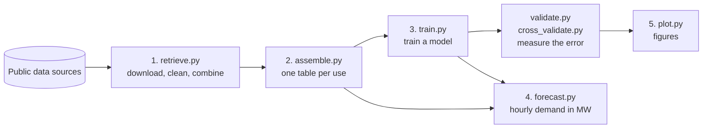

# How DemandCast works

This page gives the big picture: the steps of DemandCast, the script that runs each one, and the files that pass from one step to the next. Read it before the guides, so you know where each script fits.

## The idea in one paragraph

Electricity demand follows patterns. It rises on cold and hot days, falls at night and on holidays, and grows with income and population. DemandCast learns these patterns from the places that publish their hourly demand. It then applies them to places or years without data, using only inputs that exist everywhere: weather, population, GDP and the annual electricity use per person.

## The steps

| Step | Script | What it does | Reads | Writes (in the data folder) |
|---|---|---|---|---|
| 1 | `retrieve.py` | Downloads one kind of data, such as the demand of one data source, the population or the temperature. For electricity demand, it also cleans the data and combines all the sources of each country or subdivision. | The data sources | One folder per kind of data |
| 2 | `assemble.py` | Joins the retrieved data of many countries and subdivisions into one table, for training or for forecasting. | The retrieved data | `assembled/` |
| 3 | `train.py` | Trains a model on an assembled training table. | `assembled/` | `models/<algorithm>/` |
| 3 | `validate.py` | Measures the error of a model on the most recent year of each country and subdivision, which the training left out. | `assembled/`, `models/` | `results/validation/` |
| 3 | `cross_validate.py` | Measures the error on countries and subdivisions left out of the training entirely, to estimate the error for places without data. | `assembled/` | `results/cross_validation/` |
| 4 | `forecast.py` | Predicts the hourly demand, in MW, with a trained model and an assembled forecasting table. | `assembled/`, `models/` | `results/forecasts/` |
| 5 | `plot.py` | Draws figures of the data and of the model errors. | The data folder | `results/figures/` |

Four more scripts support these steps:

| Script | What it does | Guide |
|---|---|---|
| `check.py` | Checks which inputs each place has, tests the data sources over the network, reports the quality flags of the demand, and finds overlapping places | [Run checks](../guides/check.md) |
| `sync.py` | Copies the data folder to or from a private cloud bucket, to share it with your team | [Share the data folder](../guides/sync.md) |
| `publish.py` | Uploads a release (model, settings and forecasts) to Zenodo | [Publish a release](../guides/publish.md) |
| `python -m benchmark.run` | Retrieves and assembles the data of the benchmark of the models | [Models](models.md#benchmark) |

## What goes in and what comes out

**Inputs.** DemandCast uses two kinds of data:

- **Hourly electricity demand**: the value the model learns to predict. Only some places publish it. See [Electricity demand data](electricity-demand.md).
- **Explanatory inputs**, which exist for every country and for future years under scenarios: hourly temperature, population, GDP per person (at purchasing power parity) and the annual electricity demand per person. See [Weather and socio-economic inputs](inputs.md).

**Output.** An hourly series of electricity demand in MW for each country or subdivision and year you ask for. The model predicts the *shape* of the year: how each hour compares with the average. The annual electricity demand per person times the population gives the *level*. See [Models](models.md).

## The order to run things

1. Retrieve the data, in the [recommended order](../guides/retrieve.md#recommended-order): the population and the annual demand per person first, because the cleaning of the electricity demand compares its annual totals with them; then the electricity demand of each data source; then the GDP and the temperature.
2. Assemble a training table, train a model, and validate it.
3. Assemble a forecasting table for the places and years you want, and forecast.

[Your first forecast](../getting-started/first-forecast.md) walks through these steps for four European countries.

## How the scripts are configured

Every script reads a YAML file of settings, `config/<script>_config.yaml`, or another file given with `--config`. It checks the settings before it starts and stops with a clear error if something is wrong. The [Configuration files](../reference/configuration.md) page lists every file.

## How the scripts pass data

The scripts never call each other. Each one reads files that earlier steps wrote in the **data folder** (`demandcast/data/`, or the folder in `DEMANDCAST_DATA_FOLDER`) and writes its own files there. So you can rerun any step alone, and share the data folder with others.

Three rules keep this safe:

- **A file appears only when it is complete.** Scripts write to a temporary name and rename the file at the end. Since many steps skip files that already exist, a half-written file would otherwise be mistaken for a finished one.
- **Manifests record where each result comes from.** Each assembled table, trained model and result has a `<name>.manifest.json` file next to it, with the checksums of the file and of its inputs, the code version and the settings. Scripts check it before they use a file. See [Data folder](../reference/data-folder.md).
- **Downloads are kept.** The raw responses of the electricity demand sources are stored with every version, so you can process them again without downloading, even after a source changes or removes its data.

The [Data folder](../reference/data-folder.md) page describes every folder and file, and [Code architecture](../reference/architecture.md) describes the code behind each step.
