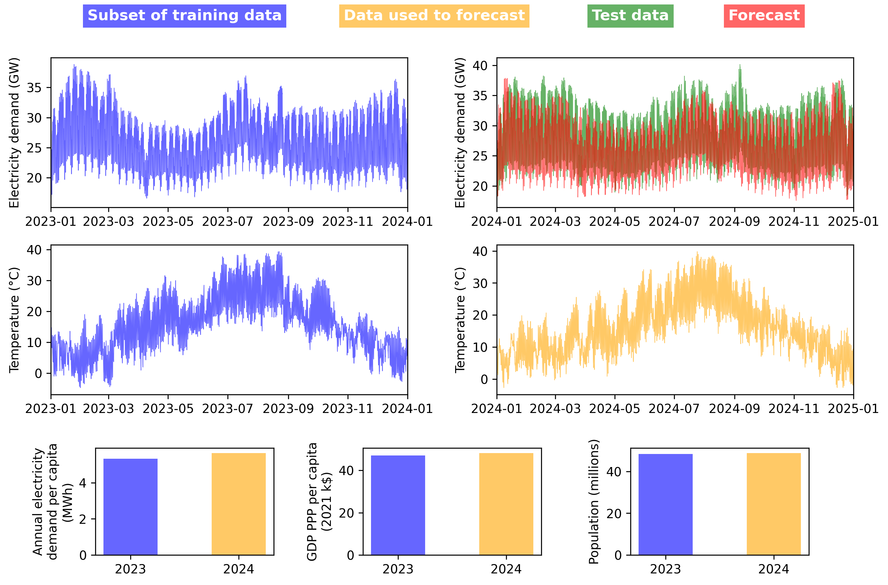

# Your first forecast

This tutorial runs the whole of DemandCast once. You retrieve data for four European countries, train a model on 2020–2023, check its error, and forecast the hourly demand of Spain in 2024. Follow [Install](install.md) first.

!!! info "Before you start"
    - You need the API keys `ENTSOE_API_KEY` (electricity demand), `EMBER_API_KEY` (annual demand per capita) and `CDS_API_KEY` (temperature). See [Install](install.md#3-add-your-api-keys).
    - The downloads take from minutes to hours, mostly for the temperature.
    - Run every command from the `demandcast/` folder.

## Step 1: list the countries

Create the file `config/tutorial_countries.yaml`, which lists the countries by their codes:

```yaml
entities:
  - country_name: France
    country_code: FRA
  - country_name: Germany
    country_code: DEU
  - country_name: Italy
    country_code: ITA
  - country_name: Spain
    country_code: ESP
```

The codes are ISO 3166 alpha-3 codes. Subdivisions, such as US states, use the [format on this page](../reference/configuration.md#a-codes-file).

## Step 2: retrieve the data

Each run of `retrieve.py` downloads one kind of data (one **variable**). Instead of editing the default settings each time, make one small settings file per variable and pass it with `--config`.

**2a. Population and annual electricity demand per capita.** Retrieve these first: the cleaning of the electricity demand compares its annual totals with them.

```yaml
# config/tutorial_population.yaml
variable: population
file: config/tutorial_countries.yaml
start_year: 2020
end_year: 2024
```

```yaml
# config/tutorial_annual_demand.yaml
variable: annual_electricity_demand_per_capita
file: config/tutorial_countries.yaml
start_year: 2020
end_year: 2024
```

```bash
uv run retrieve.py --config config/tutorial_population.yaml
uv run retrieve.py --config config/tutorial_annual_demand.yaml
```

**2b. GDP per capita.**

```yaml
# config/tutorial_gdp.yaml
variable: gdp_ppp_per_capita
file: config/tutorial_countries.yaml
start_year: 2020
end_year: 2024
```

```bash
uv run retrieve.py --config config/tutorial_gdp.yaml
```

**2c. Hourly electricity demand**, from ENTSO-E. This downloads all the years the source has, then cleans them and combines them into one hourly series per country.

```yaml
# config/tutorial_demand.yaml
variable: electricity_demand
electricity_data_source: entsoe
file: config/tutorial_countries.yaml
```

```bash
uv run retrieve.py --config config/tutorial_demand.yaml
```

**2d. Temperature.** This also downloads the population grid it needs, to find where people live in each country.

```yaml
# config/tutorial_temperature.yaml
variable: temperature
file: config/tutorial_countries.yaml
start_year: 2020
end_year: 2024
```

```bash
uv run retrieve.py --config config/tutorial_temperature.yaml
```

Everything lands in the [data folder](../reference/data-folder.md), `data/` by default. If a country fails, the script goes on with the others and lists the failures at the end; the log in `data/logs/` gives the reason.

## Step 3: assemble the training data

`assemble.py` joins all the variables into one table, with one row per hour and country.

```yaml
# config/tutorial_assemble_training.yaml
target_use: training
file: config/tutorial_countries.yaml
start_year: 2020
end_year: 2023
```

```bash
uv run assemble.py --config config/tutorial_assemble_training.yaml
```

It writes `data/assembled/assembled_data_for_training_<time>.parquet`, where `<time>` is the date and time of the run. Only years with at least 90% of their hours, and half of the hours of each month, are kept; see [Assemble a dataset](../guides/assemble.md).

## Step 4: train and validate a model

The default settings in `config/train_config.yaml` keep the most recent year of each country (2023) aside for testing, and train XGBoost on 2020–2022 with the latest assembled training data:

```bash
uv run train.py
```

The model goes to `data/models/xgboost/xgboost_model_<time>.json`, with a [manifest](../concepts/glossary.md#manifest) that records the data and settings it was trained with.

Now measure its error on 2023, which it has not seen:

```bash
uv run validate.py
```

With empty settings, `validate.py` takes the latest model and the data it was trained on. The results go to `data/results/validation/`: the error of each country as [WAPE](../concepts/glossary.md#wape) and [MAPE](../concepts/glossary.md#mape), and the hourly predictions of 2023. A WAPE of 5% means that the hourly forecast is off by 5% of the demand, summed over the year. [Train and validate](../guides/train-validate.md) explains every output.

## Step 5: assemble the forecasting data

To forecast Spain in 2024, assemble its inputs for that year. Create `config/tutorial_spain.yaml`:

```yaml
entities:
  - country_name: Spain
    country_code: ESP
```

```yaml
# config/tutorial_assemble_forecasting.yaml
target_use: forecasting
file: config/tutorial_spain.yaml
start_year: 2024
end_year: 2024
```

```bash
uv run assemble.py --config config/tutorial_assemble_forecasting.yaml
```

2024 is a past year, so no scenario is needed: the inputs are the observed values. For a future year, you would choose a scenario and a climate model; see [Assemble a dataset](../guides/assemble.md).

## Step 6: forecast

With empty settings, `forecast.py` uses the latest model and the latest forecasting data:

```bash
uv run forecast.py
```

The model predicts the shape of each hour relative to the year. `forecast.py` then scales it with the annual demand per capita times the population, so the hours of 2024 add up to Spain's annual demand. The result goes to `data/results/forecasts/with_<model>/using_<data>/all_<time>.parquet`.

## Step 7: look at the result

```python
import glob
import pandas as pd

path = sorted(glob.glob("data/results/forecasts/*/*/all_*.parquet"))[-1]
forecast = pd.read_parquet(path)
print(forecast[["Time (UTC)", "Entity code", "Forecast load (MW)"]].head())
print(forecast["Forecast load (MW)"].describe())
```

Each row is one hour: `Time (UTC)` is the end of the hour, and `Forecast load (MW)` is the mean demand during that hour.

The figure below shows the same workflow for Spain: the retrieved demand of 2023 and 2024 at the top, and the inputs of the forecast below it.



## What next

- Forecast a **future year**: retrieve the projections with a `scenario` and a `climate_model`, and assemble with the matching options. See [Weather and socio-economic inputs](../concepts/inputs.md).
- Forecast a **place without data**: list it in the forecasting codes file. The model needs only its inputs, not its demand.
- Estimate the error for places without data with [cross-validation](../guides/cross-validate.md).
- Understand the [models](../concepts/models.md) and how [electricity demand data](../concepts/electricity-demand.md) is cleaned.

!!! note
    The paths above assume the default data folder. If you set `DEMANDCAST_DATA_FOLDER`, the files are in that folder instead.
