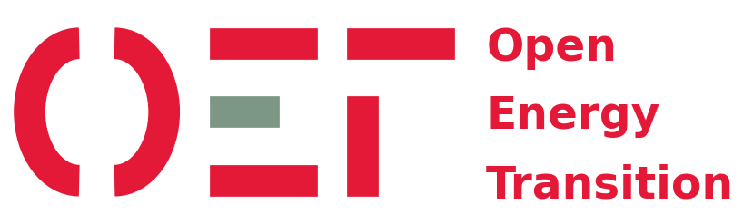
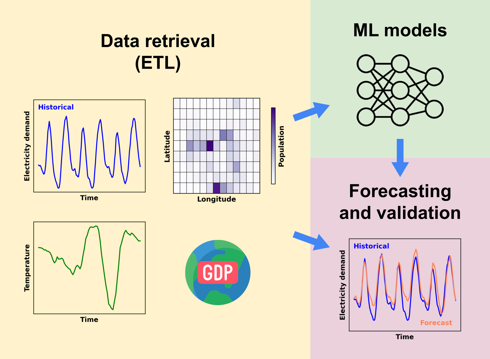

<h1 align="center"><b>DemandCast</b></h1>

<h2 align="center"><b>Global hourly electricity demand forecasting</b></h2>

<h3 align="center"><b>A project developed by</b></h3>

<p align="center">
    <a href="https://openenergytransition.org/">
        
    </a>
</p>

<h3 align="center"><b>Supported by</b></h3>

<p align="center">
    <a href="https://www.breakthroughenergy.org/">
        
    </a>
</p>

## What DemandCast does

DemandCast estimates how much electricity a country or region uses **in each hour of a year**. Energy planners need these hourly series to size power plants, grids and storage. Many places publish no such data, and no place publishes it for future years. DemandCast fills that gap.

It works in three stages:

1. **Collect** hourly electricity demand from public sources, such as grid operators, together with weather, population and economic data.
2. **Learn** how demand depends on temperature, time of day, holidays, income and other factors, by training a machine learning model on the places that have data.
3. **Forecast** the hourly demand of any country or subdivision, for past years without data or for future years under climate and socio-economic scenarios.



DemandCast models the **gross electricity demand**: all the electricity consumed, including the part supplied by rooftop solar and other generation inside the distribution networks. See [Electricity demand data](concepts/electricity-demand.md) for why this matters and how DemandCast handles sources that report something else.

## What you can get from it

- **Ready-made forecasts.** The trained model and hourly forecasts for 184 countries and 135 subdivisions from 2000 to 2025 are on [Zenodo](https://doi.org/10.5281/zenodo.18374351). You do not need to run anything to use them.
- **Your own forecasts.** Run DemandCast to forecast other years, places or scenarios. Start with [Install](getting-started/install.md) and [Your first forecast](getting-started/first-forecast.md).
- **Clean historical data.** DemandCast downloads, cleans and combines the hourly demand of many public sources. The [Current state](status.md) page shows what it covers. The data itself is not redistributed, because the licences of many sources do not allow it: you retrieve it from the sources yourself.

## Where to start

| If you want to… | Read |
|---|---|
| Understand the idea and the steps | [How DemandCast works](concepts/pipeline.md) |
| Run it for the first time | [Install](getting-started/install.md), then [Your first forecast](getting-started/first-forecast.md) |
| Look up an unfamiliar term | [Glossary](concepts/glossary.md) |
| Use one script | The [how-to guides](guides/retrieve.md), one per script |
| Know which data sources exist | [Data sources](reference/data-sources.md) |
| Change the code or add a data source | [Code architecture](reference/architecture.md) and the [contributing guidelines](https://github.com/open-energy-transition/demandcast/blob/main/CONTRIBUTING.md) |
| Fix an error | [FAQ](help/faq.md) |

## Learn more

- [Paper](https://arxiv.org/abs/2510.08000) presented at the [NeurIPS 2025 Workshop](https://www.climatechange.ai/papers/neurips2025/42): Tackling Climate Change with Machine Learning, with its [poster](https://s3.us-east-1.amazonaws.com/climate-change-ai/papers/neurips2025/42/poster.pdf) and [video](https://slideslive.com/39052515/demandcast-global-hourly-electricity-demand-forecasting).
- [Awesome Electricity Demand](https://github.com/open-energy-transition/Awesome-Electricity-Demand): the list of public sources of hourly electricity demand that DemandCast draws from.

## Roadmap

DemandCast is in active development. Planned features include:

- forecasts for user-defined regions inside countries;
- more training data: new countries and subdivisions, sectoral demand (agriculture, industry, transport, buildings), and the adoption of electric vehicles, air conditioning and heat pumps;
- new forecasting models, such as [TimesFM](https://github.com/google-research/timesfm);
- validation that checks whether forecast and actual peaks happen at the same time;
- packaging for easier installation.

## Contributing

We welcome new data sources, better models, and improvements to the documentation and tests. Read the [contributing guidelines](https://github.com/open-energy-transition/demandcast/blob/main/CONTRIBUTING.md) and the [Code of Conduct](https://github.com/open-energy-transition/demandcast/blob/main/CODE_OF_CONDUCT.md) before you open a pull request. Issues labelled [good first issue](https://github.com/open-energy-transition/demandcast/labels/good%20first%20issue) are a good place to start.

We would also like to hear from you: share your feedback in this short [survey](https://forms.gle/nMYvCAfzbrUDjqRQ8).

## Citation

If you use DemandCast in your work, please cite the [paper](https://arxiv.org/abs/2510.08000). GitHub's "Cite this repository" button gives the reference in other formats, from [CITATION.cff](https://github.com/open-energy-transition/demandcast/blob/main/CITATION.cff).

```bibtex
@inproceedings{steijn2025demandcast,
  title     = {DemandCast: Global hourly electricity demand forecasting},
  author    = {Steijn, Kevin and Goli, Vamsi Priya and Antonini, Enrico},
  booktitle = {NeurIPS 2025 Workshop: Tackling Climate Change with Machine Learning},
  year      = {2025},
  doi       = {10.48550/arXiv.2510.08000},
  url       = {https://arxiv.org/abs/2510.08000}
}
```

## Maintainers

DemandCast is maintained by the [Open Energy Transition](https://openenergytransition.org/) team:

- [Enrico Antonini](https://github.com/eantonini) (enrico.antonini at openenergytransition dot org)
- [Vamsi Priya Goli](https://github.com/Vamsipriya22) (goli.vamsi at openenergytransition dot org)

## License

DemandCast is licensed under the GNU Affero General Public License v3.0 (AGPL-3.0).
