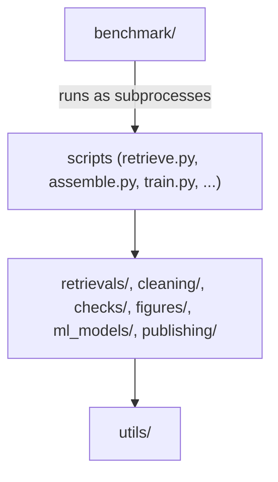

# Code architecture

This page describes the scripts, the folders of the code, how the modules depend on each other, and the tests, CI and documentation. Read it before you change the code. To add a data source or a model, follow the [contributing guidelines](https://github.com/open-energy-transition/demandcast/blob/main/CONTRIBUTING.md).


DemandCast is a set of scripts. Each script is configured by a YAML file, and the scripts pass their data to each other through the files of the [data folder](data-folder.md).

## Scripts

The scripts are in the `demandcast/` folder. Run them from that folder:

```bash
cd demandcast
uv run retrieve.py --config config/retrieve_config.yaml
```

| Script | What it does | Reads | Writes | Guide |
|---|---|---|---|---|
| `retrieve.py` | Downloads one variable: the electricity demand of a data source (then processes, cleans and combines it), the population, the GDP PPP per capita, the annual electricity demand per capita, their gridded data, the gridded weather or the temperature | The data sources | The folder of the variable | [Retrieve data](../guides/retrieve.md) |
| `assemble.py` | Merges the variables of each country and subdivision into one dataset for training or forecasting | The folders of the variables | `assembled/` | [Assemble a dataset](../guides/assemble.md) |
| `train.py` | Trains a model | `assembled/` | `models/<algorithm>/` | [Train and validate](../guides/train-validate.md) |
| `validate.py` | Scores a model on the most recent year of each country and subdivision | `assembled/`, `models/` | `results/validation/` | [Train and validate](../guides/train-validate.md) |
| `cross_validate.py` | Scores the models on the countries and subdivisions left out of their training | `assembled/` | `results/cross_validation/` | [Cross-validate](../guides/cross-validate.md) |
| `forecast.py` | Predicts the hourly electricity demand in MW with a trained model | `assembled/`, `models/` | `results/forecasts/` | [Forecast](../guides/forecast.md) |
| `plot.py` | Draws one figure: the data availability, the map of the countries and subdivisions with data, the errors of the models, or the figures and numbers of the current state | The data folder | `results/figures/`; with `figure: status`, also `README.md` and `webpage/docs/status/` | [Plot figures](../guides/plot.md) |
| `check.py` | Runs one check: the data availability, the data sources over the network, a report of the flags, or the related entities | The data folder, the data sources | `results/checks/`, and `checks/` in the code folder | [Run checks](../guides/check.md) |
| `sync.py` | Copies the data folder to or from a private bucket of Google Cloud Storage, without overwriting or deleting files | The data folder or the bucket | The bucket or the data folder | [Share the data folder](../guides/sync.md) |
| `publish.py` | Uploads a release (trained model, settings, forecasts) to Zenodo as a draft | The files of the release | A draft version of the Zenodo record | [Publish a release](../guides/publish.md) |

Two more programs run as modules, from the `demandcast/` folder:

- `uv run python -m benchmark.run [--from-step N]` retrieves and assembles the data of the benchmark of the models: Denmark, Austria and Portugal, for training on 2021 to 2023. It runs six steps (five retrievals and the assembly), each a script with its configuration file in `benchmark/`, and stops at the first that fails. `--from-step` resumes from a step (1 to 6). Its progress goes to the terminal and to `logs/benchmark_<time>.log`.
- `uv run python -m shapes.eia` defines the regions of the EIA as non-standard subdivisions (see [shapes](#shapes)). It downloads its inputs and rewrites `shapes/subdivisions/USA.yaml`.

## How a script starts

Every script follows the same steps:

1. **Read the settings.** The option `-c`/`--config` gives the YAML file. Without it, the script reads `config/<script>_config.yaml` from the code folder, whatever folder you run it from. A relative `--config` path is read from your current folder. A missing file stops the script; an empty file counts as no settings.
2. **Validate the settings.** Each script has a pydantic `ConfigModel`, a subclass of `utils.config.StrictSettings`. `StrictSettings` rejects any setting it does not know, so a misspelt option such as `start_yr` stops the script instead of being ignored. Missing required settings and invalid values also stop it, with a `Configuration validation error`.
3. **Set up the log.** `utils.config.set_up_logging` opens a new log file in `logs/` (see [Logs](data-folder.md#logs)) and the script logs its validated settings.
4. **Run its step.**

The machine learning scripts also read `config/ml_config.yaml` and `config/<algorithm>_config.yaml`. These two files always come from the `config/` folder: `--config` does not change them. `ml_models/data.py` and `ml_models/registry.py` validate them in the same strict way.

API keys come from environment variables. `utils.config.read_api_key` first loads `demandcast/.env`, without overriding variables that are already set, so a variable of your shell wins over the `.env` file. An empty key counts as missing. The keys are `CDS_API_KEY`, `ENTSOE_API_KEY`, `EIA_API_KEY`, `EMBER_API_KEY`, `EPIAS_USERNAME`, `EPIAS_PASSWORD`, `ISONE_USERNAME`, `ISONE_PASSWORD`, `ZENODO_API_KEY` and `SANDBOX_ZENODO_API_KEY`. `sync.py` uses your Google Cloud credentials instead (`gcloud auth application-default login`). The values of the variables whose names end with `_API_KEY` or `_PASSWORD` are hidden (`***`) in the messages and in the raw data.

## Code folders

```
demandcast/                         # the repository
├── .github/                        # GitHub workflows and templates
├── demandcast/                     # the Python project
│   ├── benchmark/                  # configuration and runner of the benchmark data
│   ├── checks/                     # the checks of check.py, the flag reviews and their outputs
│   ├── cleaning/                   # cleaning, flags and combination of the electricity demand
│   ├── config/                     # settings of the scripts and models, and lists of entities
│   ├── data/                       # the data folder (not in the repository)
│   ├── figures/                    # the figures of plot.py
│   ├── ml_models/                  # models, registry, data preparation, evaluation, files
│   ├── publishing/                 # copies to and from Cloud Storage, releases on Zenodo
│   ├── retrievals/                 # retrieval of each variable, and the data sources
│   ├── shapes/                     # definitions of non-standard subdivisions, EIA script
│   ├── tests/                      # pytest suite, in folders that mirror the code
│   ├── utils/                      # shared helpers
│   ├── Dockerfile                  # Docker image of the project
│   ├── pyproject.toml              # project settings and dependencies
│   ├── uv.lock                     # locked dependencies
│   └── <script>.py                 # the scripts above
├── webpage/                        # this documentation (MkDocs)
├── AGENTS.md                       # instructions for AI coding agents
├── CITATION.cff                    # citation metadata
├── CODE_OF_CONDUCT.md
├── CONTRIBUTING.md                 # guide to contributing
├── README.md                       # short overview, links to this site
├── lychee.toml                     # settings of the link checker
└── ruff.toml                       # settings of Ruff
```

Python modules are imported as top-level packages (`import utils.config`, not `import demandcast.utils.config`). That is why you run every Python command from the `demandcast/` folder.

### retrievals

The retrieval of each variable, one module each: `electricity_demand.py`, `population.py`, `gdp_ppp_per_capita.py`, `annual_electricity_demand_per_capita.py`, `gridded_population.py`, `gridded_gdp_ppp.py`, `gridded_weather.py`, `era5_points.py` and `temperature.py`. Shared steps live in:

- `indicators.py`: saves the years and scenarios of the indicators (population, GDP PPP per capita, annual electricity demand per capita);
- `gridded.py`: cuts the grid of each country and subdivision out of a global grid, and loops over the years and scenarios of the gridded population and GDP;
- `gridded_totals.py`: totals of the gridded population and GDP in the shape of a code;
- `runs.py`: runs a retrieval for each code, goes on after a code that fails, and lists the failed codes at the end.

`electricity_demand_data_sources/` holds one module and one YAML file per data source (see [Data sources](data-sources.md)). `socio_economic_data_sources/` holds the readers of Ember, the World Bank, the IMF and IIASA, the map of countries to IAM regions (`iam_regions_mapping.yaml`) and the IIASA files downloaded by hand (`manual_downloads/`).

### cleaning

The cleaning of the electricity demand. [Electricity demand data](../concepts/electricity-demand.md) explains the rules.

| Module | What it does |
|---|---|
| `electricity_demand.py` | Cleans the processed demand of one data source and code |
| `flags.py` | Flags the changes that need a review, without removing values |
| `reviews.py` | Reads the reviews of the flags in `checks/reviewed_flags.yaml` |
| `combining.py` | Combines the sources of a code into one hourly series, with the source of each hour and whether it can be used for training |

### checks

The four checks of `check.py`: `data_availability.py`, `data_sources.py`, `flags.py` and `related_entities.py`. The folder also holds inputs and outputs that live with the code:

- `reviewed_flags.yaml`: the reviews of the flags. You edit it.
- `data_availability_summary.csv`: which codes have the socio-economic data. `check.py` writes it, and `utils/availability.py` reads it to choose the codes of each step.
- `related_entities.csv`: the share of people of each pair of overlapping entities. `check.py` writes it, and `utils/relations.py` reads it for the splits of training and cross-validation.
- `related_entities_codes.txt`: the codes that the related-entities check considered. A test fails when a data source has a code missing from it, until you run the check again.

### config

The settings of each script (`<script>_config.yaml`) and of each model (`ml_config.yaml`, `xgboost_config.yaml`, `lstm_config.yaml`), plus `check_data_sources_config.yaml` and `check_flags_config.yaml`, ready-made settings of `check.py`. [Configuration files](configuration.md) lists them all.

It also holds the lists that the code and the tests read:

| File | What it lists | Read by |
|---|---|---|
| `world_countries.yaml` | The countries of the world, with names and ISO 3166 alpha-3 codes, in the format of a data source YAML | The tests of the data sources, which check each source's countries against it |
| `available_subdivisions.yaml` | The subdivisions that data sources may have, with their country, code and name | The tests of the data sources |
| `continents.yaml` | The continent code of each country (AF, AN, AS, EU, NA, OC, SA) | `utils/codes.py`, `figures/data_availability.py` |
| `related_entities.yaml` | Exceptions to the related entities: pairs that are always related (`related`) or never (`unrelated`) | `utils/relations.py` |
| `oet_zenodo_metadata.yaml` | The creators and contributors of a Zenodo record | `publishing/zenodo.py` (the `metadata_file` of `publish.py`) |

### shapes

`shapes/subdivisions/<ISO3>.yaml` defines the non-standard subdivisions of each country by the standard subdivisions of Natural Earth that make them up, minus the parts that some polygons cut out. `utils/shapes.py` reads these files. `shapes/eia.py` writes the regions of the EIA into `USA.yaml`: each county of the lower 48 states goes to the region whose balancing authorities sell the most electricity in it, and the other subdivisions of the file are kept.

### figures

One module per figure of `plot.py`: `data_availability.py`, `map_of_available_entities.py`, `ml_results.py` and `status.py` (the figures and numbers of the [Current state](../status.md) page).

### publishing

- `gcs.py`: the copies of `sync.py` to and from Google Cloud Storage.
- `zenodo.py`: the upload of `publish.py` to Zenodo.
- `release/README.md` and `release/metadata.yaml`: the README uploaded with each release, and its hand-written metadata.

### ml_models

| Module | What it does |
|---|---|
| `__init__.py` | Imports PyTorch first when it is installed, because on Windows PyTorch must be imported before pandas |
| `registry.py` | Lists the models (`MODEL_MODULES`), defines the interface of their modules (`ModelModule`) and reads their settings |
| `xgboost.py`, `lstm.py` | The models: settings, training, prediction, saving and loading |
| `data.py` | Reads `config/ml_config.yaml` and the assembled data, converts the target, and splits the rows into sets |
| `evaluation.py` | Computes the MAPE and WAPE, and runs the cross-validation |
| `reporting.py` | Describes the scored entities and summarizes the errors by group |
| `files.py` | Finds the latest model and dataset, saves the results and writes and checks the model manifests |
| `torch_windows.py` | Registers the DLL folder of PyTorch on Windows |

[Models](../concepts/models.md) explains the models.

### utils

The helpers that all steps share. Every module here has at least 95% test coverage in CI.

| Module | What it does |
|---|---|
| `availability.py` | Gives the codes of interest of a step and checks they have its data (electricity demand, historical data, or all data with projections) |
| `catalogue.py` | Lists the SSP, IAMC and CMIP6 scenarios, the climate models and the years of each projection and gridded dataset |
| `codes.py` | ISO codes, names and continents of countries and subdivisions |
| `columns.py` | The names of the shared columns: `Time (UTC)`, `Entity code`, `Local year` |
| `config.py` | Reads and validates the settings (`StrictSettings`), reads API keys, sets up the log |
| `data_sources.py` | Reads and validates the YAML files of the data sources: licence, definition of the demand, entities and dates |
| `fetcher.py` | Downloads data with retries, hides API keys in messages, and reads manual downloads |
| `figures.py` | Saves figures atomically, and draws quick plots of a shape or a grid |
| `files.py` | Writes files atomically (`writing`) |
| `geospatial.py` | Handles grids: coordinates, coarsening, density to count, cell weights in a shape, totals in a shape |
| `manifest.py` | Writes and checks the [manifests](data-folder.md#manifests) |
| `paths.py` | All the paths of the code folder and the data folder |
| `public_holidays.py` | Tells which hours fall on a public holiday of a code |
| `raw_data.py` | Keeps the raw responses of the data sources, and replays them to process the data again without the network |
| `relations.py` | Tells which entities are related, from `checks/related_entities.csv` and `config/related_entities.yaml` |
| `scenarios.py` | Selects the years, scenarios and climate models that a retrieval downloads |
| `shapes.py` | Gets the shapes of countries and subdivisions from Natural Earth and from `shapes/subdivisions/` |
| `time_series.py` | Splits periods, localizes interval starts, gives local years, converts yearly values to hourly ones and saves them |
| `time_zones.py` | Gives the time zone of a country or subdivision, and the local day of each hour |

### benchmark

The configuration files of the benchmark (`codes.yaml`, one `retrieve_*.yaml` per variable and `assemble.yaml`) and `run.py`, which runs them.

### tests

The pytest suite, in folders that mirror the code: the tests of `utils/fetcher.py` are in `tests/utils/test_fetcher.py`. The tests of the scripts are at the top of `tests/`. See [Tests](#tests) below.

## Dependency rule

Dependencies go one way:



The modules of `utils/` import none of the packages and scripts above them, so that each can be used and tested alone. `tests/utils/test_dependencies.py` checks it: it parses every file of `utils/` and fails if one imports (also inside a function, or through `importlib.import_module`) `retrievals`, `cleaning`, `checks`, `figures`, `ml_models`, `publishing`, `benchmark` or a script.

Between the packages:

- the electricity demand retrieval (`retrievals/electricity_demand.py`) cleans and combines the data with `cleaning/`;
- the combination reads the flag reviews with `cleaning/reviews.py`, which the flag report (`checks/flags.py`) also uses;
- the data availability check and its figure read the annual data with the modules of `retrievals/`;
- `figures/ml_results.py` reads the results with `ml_models/files.py`;
- `assemble.py` brings the combined demand up to date with `cleaning/combining.py`.

## Lists written once

Each list that the code needs is written in one place. Use it instead of writing the list again:

| Where | What |
|---|---|
| `utils/paths.py` | The folders and files of the code and of the data. Never hard-code a path. |
| `utils/catalogue.py` | The scenarios (SSP, IAMC, CMIP6), the climate models and the years of each projection and gridded dataset |
| `utils/columns.py` | The shared column names: use `utils.columns.TIME`, `ENTITY_CODE` and `LOCAL_YEAR` in the code |
| `utils/codes.py`, `utils/time_zones.py` | ISO codes, names, continents and time zones |
| `utils/data_sources.py` | The registry of the data sources, from their YAML files |
| `ml_models/registry.py` | The models (`MODEL_MODULES`) and the interface of their modules |
| `retrieve.py` | The retrieval of each variable (`RETRIEVALS`) |
| `assemble.py` | The inputs of the assembled datasets (`DATASETS`): a new input is a new row, with its folder, columns and scenarios |

## Writing files

Write every data file through `utils.files.writing`, and every figure through `utils.figures.save_figure`. They give a file its name only once it is complete, because several steps keep the files that exist. [How files are written](data-folder.md#how-files-are-written) explains why.

Build paths with `os.path.join` or `pathlib`, also in tests: the code must work on Windows, and CI runs the tests on Windows.

## Tests

Run the tests from the `demandcast/` folder:

```bash
uv sync --extra lstm
uv run --extra lstm pytest
uv run --extra lstm mypy
```

The rules of the suite:

- **No network.** Tests write their files to `tmp_path` and mock downloads. CI points `HTTP_PROXY` and `HTTPS_PROXY` to a closed port, so a test that downloads fails.
- **Temporary data folder.** The autouse fixture `tmp_data_folder` (in `tests/conftest.py`) sets `DEMANDCAST_DATA_FOLDER` to a temporary folder in every test. Inputs of the code folder, such as the configuration, stay where they are.
- **Fake downloads.** The `fake_downloads` fixture (in `tests/retrievals/electricity_demand_data_sources/conftest.py`) replaces the downloads of `requests` and `urllib` with small synthetic files in `fixtures/`. The `assert_demand` fixture checks the series that a data source returns. The tests of the socio-economic sources reuse `fake_downloads`.
- **Network tests.** The rare tests that need real data are marked `@pytest.mark.network`. The default options (`-m "not network"`) leave them out. Run them with `uv run pytest -m network`, as the weekly live check does.
- **Warnings are errors.** `DeprecationWarning`, `PendingDeprecationWarning` and `FutureWarning` fail the tests, so that an upgrade of a dependency fails loudly instead of changing results silently.
- **Other fixtures.** `fresh_shapes` clears the cached bounds and fingerprints of shapes between tests; `longitude` gives every entity the longitude of Paris for the flags; `frozen_now` freezes the time of pandas at 2026-01-02 03:04:05.
- **Coverage.** CI requires at least 95% coverage of the whole code and 95% of `utils/`, and at least 80% of the lines that a pull request changes. Maintainers can skip the last check for mechanical changes with the `skip-diff-cover` label.

Some tests check the project itself: `test_script_configs.py` checks that every option of every script appears in its YAML file (marked `REQUIRED` or `OPTIONAL`) and in `webpage/docs/`; `test_versions.py` checks that `pyproject.toml` and `CITATION.cff` have the same version; `test_import_order.py` and `test_optional_torch.py` check that the scripts import PyTorch first and work without it.

## pre-commit

The pre-commit hooks lint, format and check every file. Install them once, then they run on each commit:

```bash
uvx pre-commit install
uvx pre-commit run --all-files
```

They include: Ruff (lint and format, lines of at most 79 characters), mypy (in the project's environment), file checks (large files over 1000 kB, YAML, JSON, TOML, merge conflicts, line endings, Windows-illegal names, private keys), `uv lock --check` for both projects, prettier for YAML and JSON, checks of the GitHub workflows (actionlint, zizmor, schema), hadolint for the Dockerfile, shellcheck, gitleaks for secrets, typos for spelling, and nbstripout for notebooks.

## Continuous integration

The workflows are in `.github/workflows/`:

| Workflow | When | What it does |
|---|---|---|
| `ci.yml` | Pull requests and pushes to `main` | Runs pre-commit, the tests (Ubuntu with Python 3.12 and 3.14, Windows with Python 3.12), the coverage checks, mypy, the strict build of this site and a Docker build. Pull requests that change only documentation skip the tests, mypy and the Docker build. A single "CI result" job gathers the others. |
| `codeql.yml` | Pull requests, pushes to `main`, weekly | Analyses the code with CodeQL |
| `dependency-review.yml` | Pull requests | Fails on new dependencies with known vulnerabilities or licences incompatible with AGPL-3.0 |
| `pr-checks.yml` | Pull requests | Checks that the title follows Conventional Commits and that every commit is signed off (DCO) |
| `labeler.yml` | Pull requests | Labels pull requests by the files they change and the type in their title |
| `awesome-list.yml` | Pull requests that change data source YAML files | Warns about sources missing from the Awesome Electricity Demand list, without failing |
| `links.yml` | Weekly, and pull requests that change Markdown files | Checks the links with lychee (settings in `lychee.toml`) |
| `live-check.yml` | Weekly, on `main` | Checks the data sources over the network, keeps one issue open with the sources that fail two checks in a row, and runs the `network` tests |
| `docs.yml` | Pushes to `main` that change `webpage/` | Builds this site and deploys it to GitHub Pages |
| `docker-publish.yml` | Pushes to `main` and version tags | Publishes, signs and attests the Docker image; on a tag, first checks the versions of `pyproject.toml` and `CITATION.cff` |
| `scorecard.yml` | Weekly and pushes to `main` | Runs the OpenSSF Scorecard security analysis |
| `copilot-setup-steps.yml` | When it changes | Prepares the environment of the GitHub Copilot coding agent |

## Documentation site

This site is in `webpage/`, a separate uv project built with MkDocs and the Material theme. The pages are Markdown files in `webpage/docs/`, and `webpage/mkdocs.yml` sets the navigation. To preview it while you edit:

```bash
cd webpage
uv run mkdocs serve
```

Then open the address it prints (by default `http://127.0.0.1:8000`). Before you push, build it as CI does, which fails on broken links or missing pages:

```bash
cd webpage
uv run mkdocs build --strict
```

The [Current state](../status.md) page includes files that `plot.py` writes into `webpage/docs/status/`. Update this page when you add a script, a folder or a dependency between packages.
