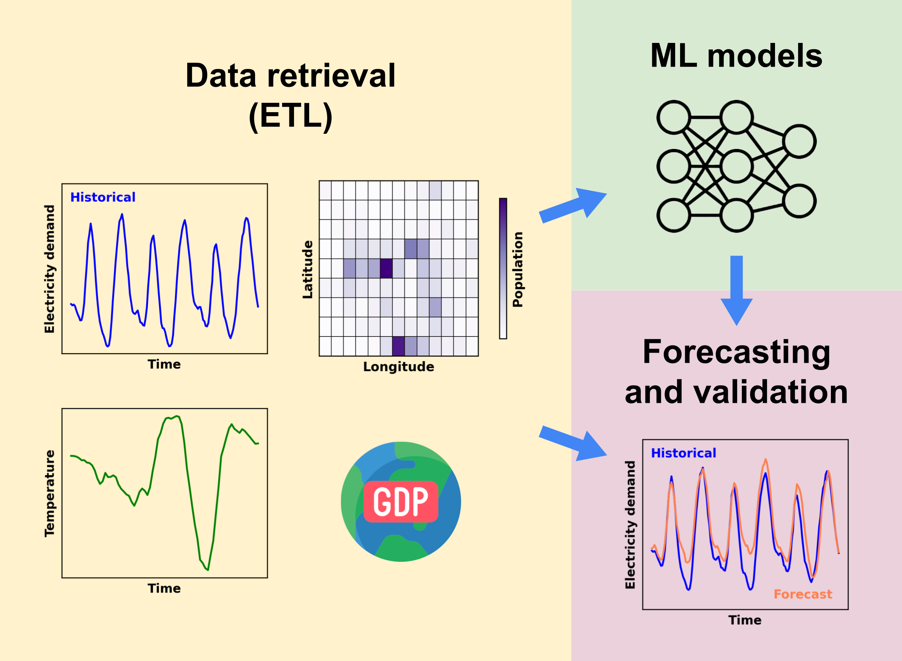
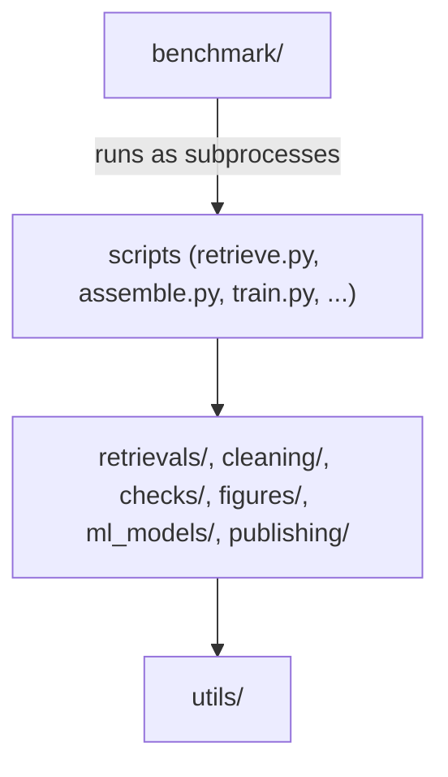

# Code architecture

This page is for contributors: the scripts, the folders of the code, the rules between modules, and the tests, CI and documentation. To add a data source or a model, follow the [contributing guidelines](https://github.com/open-energy-transition/demandcast/blob/main/CONTRIBUTING.md).



DemandCast is a set of scripts. Each one is configured by a YAML file, and they pass data to each other through the files of the [data folder](data-folder.md).

## Scripts

The scripts are in `demandcast/`. Run them, and every Python command, from that folder, since the modules are imported as top-level packages (`import utils.config`, not `import demandcast.utils.config`):

```bash
cd demandcast
uv run retrieve.py --config config/retrieve_config.yaml
```

| Script | What it does | Guide |
|---|---|---|
| `retrieve.py` | Downloads one variable: the electricity demand of a data source (then processes, cleans and combines it), an indicator, a gridded dataset, the weather or the temperature | [Retrieve data](../guides/retrieve.md) |
| `assemble.py` | Merges the variables of each country and subdivision into one dataset, for training or forecasting | [Assemble a dataset](../guides/assemble.md) |
| `train.py` | Trains a model | [Train and validate](../guides/train-validate.md) |
| `validate.py` | Scores a model on the most recent year of each country and subdivision | [Train and validate](../guides/train-validate.md) |
| `cross_validate.py` | Scores the models on the entities left out of their training | [Cross-validate](../guides/cross-validate.md) |
| `forecast.py` | Predicts the hourly electricity demand in MW | [Forecast](../guides/forecast.md) |
| `plot.py` | Draws one figure, or the figures and numbers of the [Current state](../status.md) page | [Plot figures](../guides/plot.md) |
| `check.py` | Runs one check: data availability, data sources, flags or related entities | [Run checks](../guides/check.md) |
| `sync.py` | Copies the data folder to or from a Google Cloud Storage bucket, without overwriting or deleting | [Share the data folder](../guides/sync.md) |
| `publish.py` | Uploads a release to Zenodo as a draft | [Publish a release](../guides/publish.md) |
| `python -m benchmark.run [--from-step N]` | Retrieves and assembles the benchmark data, in six steps; `--from-step` resumes from step 1 to 6 | [Models](../concepts/models.md#benchmark) |
| `python -m shapes.eia` | Defines the EIA regions as [non-standard subdivisions](../concepts/glossary.md#non-standard-subdivision) and rewrites `shapes/subdivisions/USA.yaml` | [Retrieve data](../guides/retrieve.md#non-standard-subdivisions) |

[Data folder](data-folder.md) lists which script writes and reads each file.

### How a script starts

1. **Read the settings** with `utils.config.read_and_check_configuration`. The option `-c`/`--config` gives the YAML file; without it, the script reads `config/<script>_config.yaml` from the code folder, whatever your current folder. A relative `--config` is read from your current folder. A missing file stops the script; an empty file counts as no settings.
2. **Validate them** with the script's pydantic `ConfigModel`, a subclass of `utils.config.StrictSettings`. It rejects unknown settings, so a misspelt option such as `start_yr` stops the script instead of being ignored. Errors start with `Configuration validation error`.
3. **Set up the log** with `utils.config.set_up_logging`, which opens a new file in [`logs/`](data-folder.md#logs), and log the validated settings.
4. **Run the step.**

The machine learning scripts also read `config/ml_config.yaml` and `config/<algorithm>_config.yaml`, always from `config/` (`--config` does not change them), validated in the same strict way by `ml_models/data.py` and `ml_models/registry.py`.

API keys come from environment variables. `utils.config.read_api_key` first loads `demandcast/.env` without overriding variables already set, and treats an empty key as missing. `utils/fetcher.py` hides the values of variables whose names end with `_API_KEY` or `_PASSWORD` (`***`) in messages and raw data. [Install](../getting-started/install.md#3-add-your-api-keys) lists the keys.

## Code folders

```
demandcast/                          # the repository
├── .github/                         # workflows and templates
├── demandcast/                      # the Python project
│   ├── benchmark/                   # settings of the benchmark steps, and run.py
│   ├── checks/                      # the four checks of check.py, flag reviews, outputs kept with the code
│   ├── cleaning/
│   │   ├── electricity_demand.py    # cleans one source and code
│   │   ├── flags.py                 # flags changes for review, without removing values
│   │   ├── reviews.py               # reads checks/reviewed_flags.yaml
│   │   └── combining.py             # combines the sources of a code into one hourly series
│   ├── config/                      # settings of the scripts and models, and lists of entities
│   ├── data/                        # the data folder (not in the repository)
│   ├── figures/                     # one module per figure of plot.py
│   ├── ml_models/
│   │   ├── __init__.py              # imports PyTorch first, if installed (needed on Windows)
│   │   ├── registry.py              # the models (MODEL_MODULES), their interface (ModelModule), their settings
│   │   ├── xgboost.py, lstm.py      # the models: settings, training, prediction, saving, loading
│   │   ├── data.py                  # ml_config.yaml, reading the data, target, sets
│   │   ├── evaluation.py            # MAPE, WAPE, cross-validation
│   │   ├── reporting.py             # scored entities, errors by group
│   │   ├── files.py                 # latest model and dataset, results, model manifests
│   │   └── torch_windows.py         # registers the DLL folder of PyTorch on Windows
│   ├── publishing/
│   │   ├── gcs.py                   # the copies of sync.py
│   │   ├── zenodo.py                # the uploads of publish.py
│   │   └── release/                 # README.md and metadata.yaml of each release
│   ├── retrievals/
│   │   ├── <variable>.py            # one module per variable, including era5_points.py
│   │   ├── indicators.py            # saves the years and scenarios of the indicators
│   │   ├── gridded.py               # cuts each code out of a global grid
│   │   ├── gridded_totals.py        # totals of the gridded population and GDP in a shape
│   │   ├── runs.py                  # runs each code, goes on after failures, lists them
│   │   ├── electricity_demand_data_sources/  # one module and one YAML file per source
│   │   └── socio_economic_data_sources/      # Ember, World Bank, IMF, IIASA readers and files
│   ├── shapes/                      # subdivisions/<ISO3>.yaml and eia.py
│   ├── tests/                       # pytest suite, in folders that mirror the code
│   ├── utils/                       # shared helpers (below)
│   ├── Dockerfile                   # see Docker guide
│   ├── pyproject.toml, uv.lock      # project settings and locked dependencies
│   └── <script>.py                  # the scripts above
├── webpage/                         # this documentation site
├── AGENTS.md                        # instructions for AI coding agents
├── CITATION.cff                     # citation metadata
├── CONTRIBUTING.md                  # contributing and releasing
├── README.md                        # short overview
├── lychee.toml                      # link checker settings
└── ruff.toml                        # Ruff settings
```

[Configuration files](configuration.md) explains the files of `config/`, `checks/` and `shapes/`; [Data sources](data-sources.md) the data source files.

### utils

| Module | What it does |
|---|---|
| `availability.py` | The codes of interest of a step, checked for its data (electricity demand, historical data, or all data with projections) |
| `catalogue.py` | The SSP, IAMC and CMIP6 scenarios, the climate models and the years of each projection and gridded dataset |
| `codes.py` | ISO codes, names and continents |
| `columns.py` | Shared column names: `TIME` (`Time (UTC)`), `ENTITY_CODE` (`Entity code`), `LOCAL_YEAR` (`Local year`) |
| `config.py` | Settings (`StrictSettings`), API keys, log setup |
| `data_sources.py` | Reads and validates the data source YAML files |
| `fetcher.py` | Downloads with retries, hides API keys, reads manual downloads |
| `figures.py` | Saves figures atomically (`save_figure`), quick plots of a shape or grid |
| `files.py` | Writes files atomically (`writing`) |
| `geospatial.py` | Grids: coordinates, coarsening, density to count, cell weights and totals in a shape |
| `manifest.py` | Writes and checks the [manifests](data-folder.md#manifests) |
| `paths.py` | Every path of the code folder and the data folder |
| `public_holidays.py` | The hours on a public holiday of a code |
| `raw_data.py` | Keeps the raw responses of the data sources, and replays them offline |
| `relations.py` | Related entities, from `checks/related_entities.csv` and `config/related_entities.yaml` |
| `scenarios.py` | The years, scenarios and climate models that a retrieval downloads |
| `shapes.py` | Shapes from Natural Earth and `shapes/subdivisions/` |
| `time_series.py` | Splits periods, localizes interval starts, local years, yearly values to hourly ones |
| `time_zones.py` | The time zone of a code, and the local day of each hour |

## Rules for contributors

### Dependency rule

Dependencies go one way:



`utils/` imports none of the packages and scripts above it, so each module can be used and tested alone. `tests/utils/test_dependencies.py` parses every file of `utils/` and fails if one imports `retrievals`, `cleaning`, `checks`, `figures`, `ml_models`, `publishing`, `benchmark` or a script, also inside a function or through `importlib.import_module`.

Between packages: `retrievals/electricity_demand.py` and `assemble.py` use `cleaning/` to clean and combine; `cleaning/reviews.py` is shared by the combination and the flag report (`checks/flags.py`); the data availability check and figure read annual data with `retrievals/`; `figures/ml_results.py` reads results with `ml_models/files.py`.

### Lists written once

Use these instead of writing a list again:

| Where | What |
|---|---|
| `utils/paths.py` | Every folder and file. Never hard-code a path. |
| `utils/catalogue.py` | Scenarios, climate models and years |
| `utils/columns.py` | Shared column names |
| `utils/codes.py`, `utils/time_zones.py` | ISO codes, names, continents, time zones |
| `utils/data_sources.py` | The registry of the data sources |
| `ml_models/registry.py` | The models and their interface |
| `retrieve.py` | The retrieval of each variable (`RETRIEVALS`) |
| `assemble.py` | The inputs of the assembled datasets (`DATASETS`): a new input is a new row, with its folder, columns and scenarios |

### Writing files

Write every data file through `utils.files.writing` and every figure through `utils.figures.save_figure`, so a file gets its name only once complete ([why](data-folder.md#how-files-are-written)). Build paths with `os.path.join` or `pathlib`, also in tests: CI runs the tests on Windows.

## Tests

From `demandcast/`:

```bash
uv sync --extra lstm
uv run --extra lstm pytest
uv run --extra lstm mypy
```

The tests live in `tests/`, in folders that mirror the code (`utils/fetcher.py` → `tests/utils/test_fetcher.py`); the tests of the scripts are at the top.

| Rule or tool | What it does |
|---|---|
| No network | Tests write to `tmp_path` and mock downloads. CI points `HTTP_PROXY` and `HTTPS_PROXY` to a closed port, so a test that downloads fails. |
| `tmp_data_folder` (autouse, `tests/conftest.py`) | Sets `DEMANDCAST_DATA_FOLDER` to a temporary folder in every test; inputs of the code folder stay in place |
| `fresh_shapes` (autouse) | Clears the cached bounds and fingerprints of shapes between tests |
| `longitude`, `frozen_now` | Give every entity the longitude of Paris for the flags; freeze the time of pandas at 2026-01-02 03:04:05 |
| `fake_downloads`, `assert_demand` (`tests/retrievals/electricity_demand_data_sources/conftest.py`) | Replace the downloads of `requests` and `urllib` with small files in `fixtures/` (also for the socio-economic sources); check the series a source returns |
| `@pytest.mark.network` | Tests that need real data. Left out by default (`-m "not network"`); run them with `uv run pytest -m network`, as the weekly live check does. |
| Warnings are errors | `DeprecationWarning`, `PendingDeprecationWarning` and `FutureWarning` fail the tests, so an upgrade fails loudly instead of changing results silently |
| Coverage (CI) | At least 95% of the whole code, 95% of `utils/` taken together, and 80% of the lines a pull request changes. The `skip-diff-cover` label skips the last check for mechanical changes. |
| Project checks | `test_script_configs.py`: every option of every script is in its YAML file (marked `REQUIRED` or `OPTIONAL`) and in `webpage/docs/`. `test_versions.py`: `pyproject.toml` and `CITATION.cff` have the same version. `test_import_order.py`, `test_optional_torch.py`: the scripts import PyTorch first and work without it. |

## pre-commit

```bash
uvx pre-commit install           # once; then the hooks run on each commit
uvx pre-commit run --all-files
```

The hooks run Ruff (lint and format, lines of at most 79 characters), mypy, file checks (files over 1000 kB, YAML, JSON, TOML, merge conflicts, line endings, Windows-illegal names, private keys), `uv lock --check` for both uv projects, prettier for YAML and JSON, workflow checks (actionlint, zizmor, schemas), hadolint, shellcheck, gitleaks, typos and nbstripout.

## Continuous integration

The workflows are in `.github/workflows/`:

| Workflow | When | What it does |
|---|---|---|
| `ci.yml` | Pull requests, pushes to `main` | pre-commit, tests (Ubuntu with Python 3.12 and 3.14, Windows with 3.12), coverage, mypy, strict build of this site, Docker build. Documentation-only pull requests skip the tests, mypy and Docker. One "CI result" job gathers the others. |
| `codeql.yml` | Pull requests, pushes to `main`, weekly | CodeQL analysis |
| `dependency-review.yml` | Pull requests | Fails on new dependencies with known vulnerabilities or licences incompatible with AGPL-3.0 |
| `pr-checks.yml` | Pull requests | Conventional Commits title, DCO sign-off of every commit |
| `labeler.yml` | Pull requests | Labels by changed files and title type |
| `awesome-list.yml` | Pull requests that change data source YAML files | Warns about sources missing from the Awesome Electricity Demand list |
| `links.yml` | Weekly, pull requests that change Markdown | Checks links with lychee (`lychee.toml`) |
| `live-check.yml` | Weekly, on `main` | Checks the data sources over the network, keeps one issue open with those that fail two checks in a row, runs the `network` tests |
| `docs.yml` | Pushes to `main` that change `webpage/` | Builds this site and deploys it to GitHub Pages |
| `docker-publish.yml` | Pushes to `main`, version tags | Publishes, signs and attests the [Docker image](../guides/docker.md#how-the-image-is-published) |
| `scorecard.yml` | Weekly, pushes to `main` | OpenSSF Scorecard |
| `copilot-setup-steps.yml` | When it changes | Prepares the environment of the GitHub Copilot coding agent |

## Documentation site

This site is in `webpage/`, a separate uv project built with [Zensical](https://zensical.org/). The pages are Markdown files in `webpage/docs/`; `webpage/mkdocs.yml` sets the navigation, the theme and the extensions.

```bash
cd webpage
uv run zensical serve             # preview at http://localhost:8000
uv run zensical build --strict    # build as CI does
```

The strict build fails on any warning, such as a broken link or a link to an anchor that does not exist. When you move or rename a page, add its old address to `redirect_maps` of the `redirects` plugin in `mkdocs.yml`: Zenodo records and other sites link to it.

The [Current state](../status.md) page includes files that `plot.py` writes into `webpage/docs/status/`. Update this page when you add a script, a folder or a dependency between packages.
