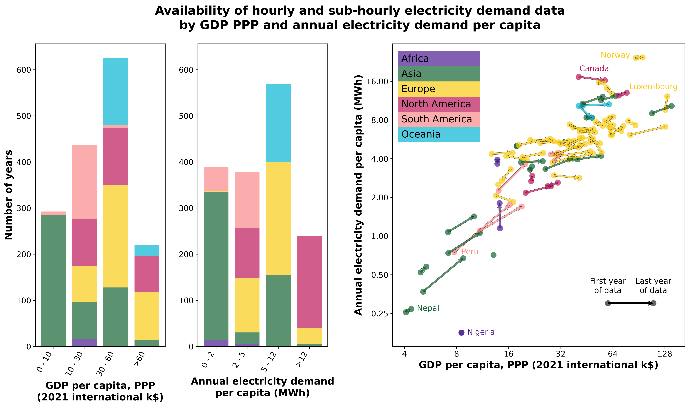
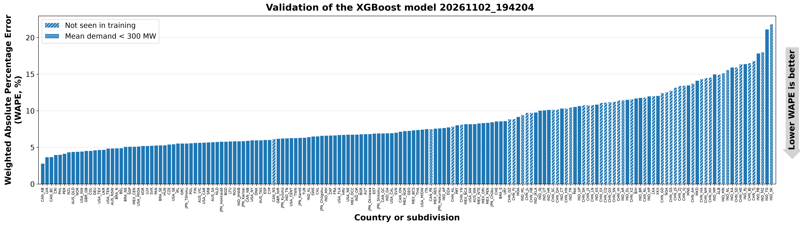
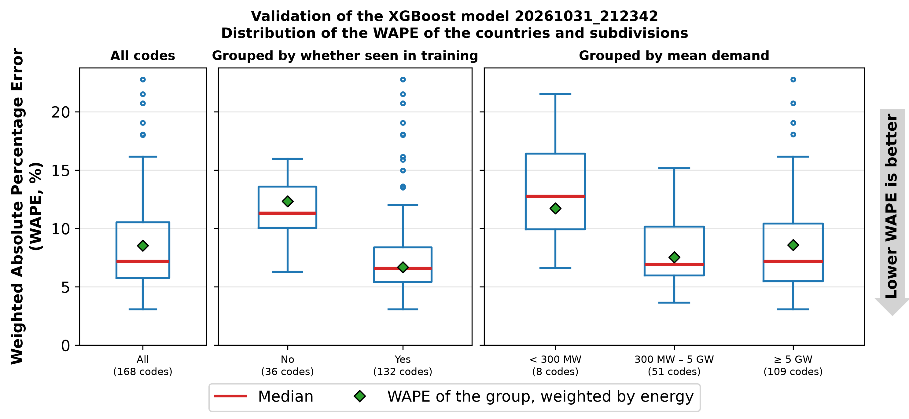
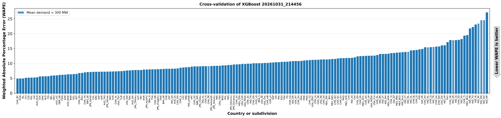
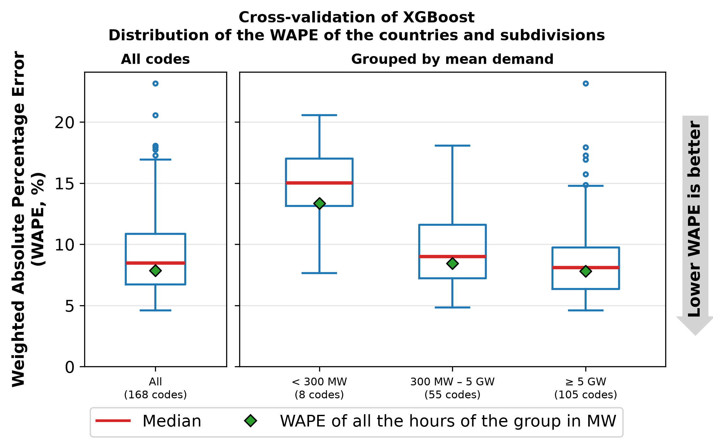

# Current state

This page shows, at a high level, the electricity demand data that DemandCast retrieves and the errors of the forecasts of its models. Its figures and numbers are drawn by `plot.py` with `figure: status` (see [Analyzing and plotting data](plot.md)).

## Data

--8<-- "status/numbers.md"

The map shows the countries and subdivisions for which retrieval modules of electricity demand data are available, with the years of their data.

The figure below shows the years of data by GDP PPP per capita and by annual electricity demand per capita, by continent, and how they changed in each country between its first and last year of data. It shows which kinds of countries the training data covers, and therefore where the models extrapolate when they forecast the demand of the countries without data.

The [data retrieval](retrieval.md) page describes the data sources, and how their data is cleaned and combined.

## Forecast errors

The models forecast the hourly electricity demand of each year of a country or subdivision. Their error is the weighted absolute percentage error (WAPE): the sum of the absolute differences between the forecast and the actual hourly demand, divided by the sum of the actual demand. Lower is better.

--8<-- "status/ml_results.md"

The validation trains the model on all the years of data but the most recent one of each country and subdivision, and scores it on that year. The countries and subdivisions with a single year of data are only scored, so the model never saw them in training. Each bar is the error of a country or subdivision, hatched with lines if the model never saw it in training, and with dots if its mean demand is below 300 MW.

The boxes show how the errors spread: for all the countries and subdivisions, for those that the model saw in training or not, and by mean demand. The red line is the median of the group, and the green diamond the error of the group as a whole, in which the largest systems weigh the most.

The cross-validation trains a model without each country, with its subdivisions, and scores it on that country, as the models forecast the countries without data.

The [machine learning](ML.md) page describes the models and how they are validated.
