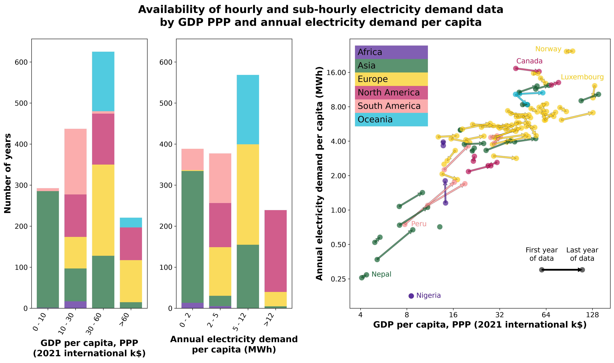
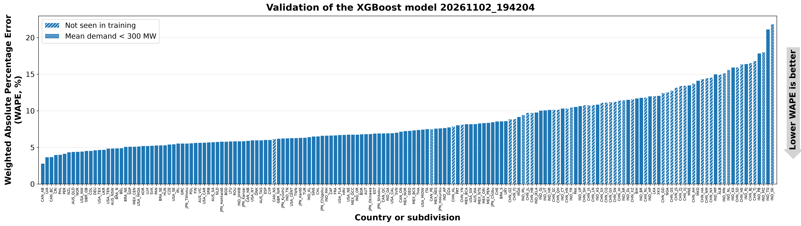
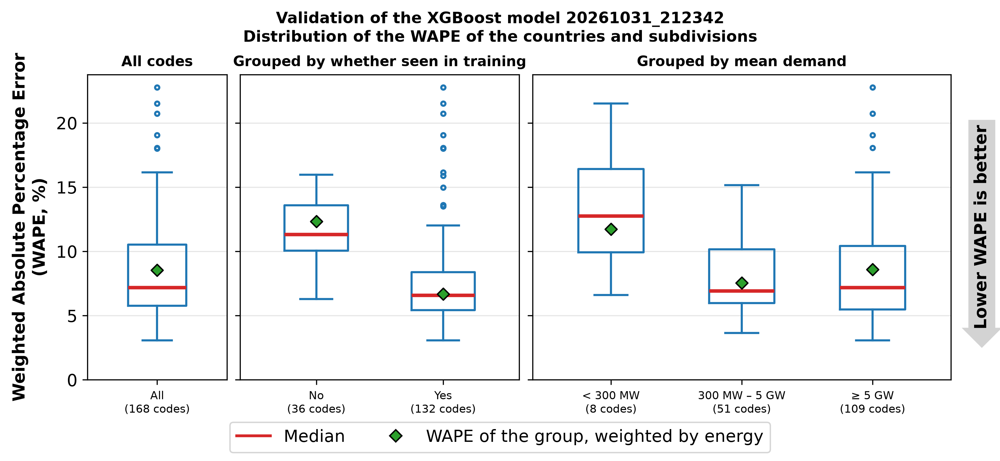
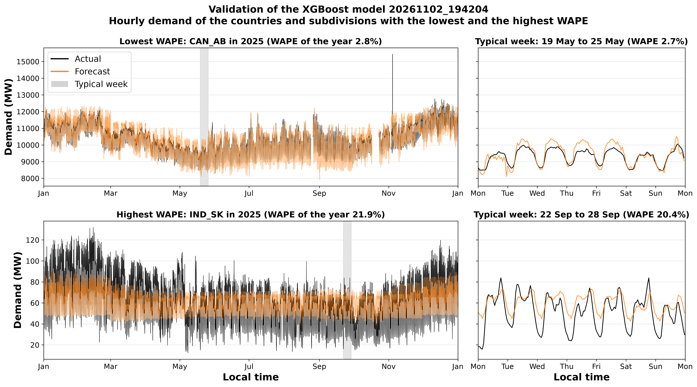
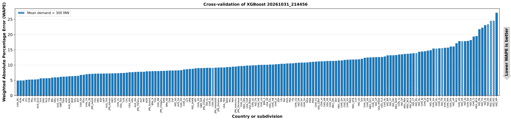
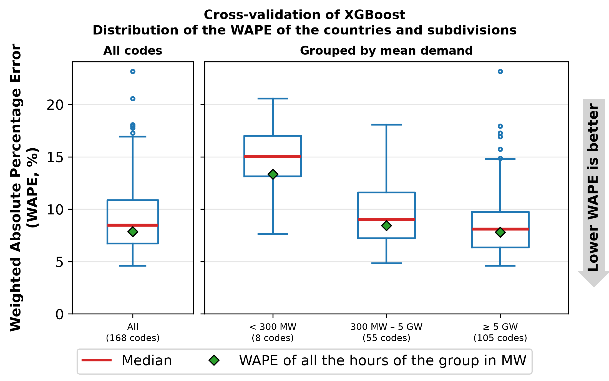
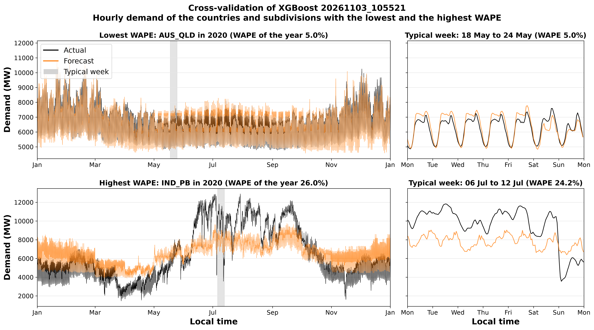

# Current state

This page shows, at a high level, the electricity demand data that DemandCast retrieves and the errors of the forecasts of its models. Its figures and numbers are drawn by `plot.py` with `figure: status` (see [Plot figures](guides/plot.md)).

## Data

--8<-- "status/numbers.md"

The map shows the countries and subdivisions for which retrieval modules of electricity demand data are available, with the years of their data.

The figure below sorts the years of data by the GDP PPP per capita and the annual electricity demand per capita of their country, by continent. Its arrows show how each country moved between its first and last year of data. It tells which kinds of countries the training data covers, and so where the models extrapolate when they forecast places without data.

The [Data sources](reference/data-sources.md) page lists the data sources, and [Electricity demand data](concepts/electricity-demand.md) explains how their data is cleaned and combined.

## Forecast errors

The models forecast the hourly electricity demand of each year of a country or subdivision. Their error is the weighted absolute percentage error (WAPE): the sum of the absolute differences between the forecast and the actual hourly demand, divided by the sum of the actual demand. Lower is better.

The models are scored in two ways: a validation, on the most recent year of the countries and subdivisions with data, and a cross-validation, on countries and subdivisions whose data the model never saw.
--8<-- "status/ml_model.md"

### Validation

The validation trains the model on all the years of data but the most recent one of each country and subdivision, and scores it on that year. The countries and subdivisions with a single year of data are only scored, so the model never saw them in training. It tells how well the model forecasts a new year of the places it learned from.

--8<-- "status/ml_validation.md"

Each bar is the error of a country or subdivision, hatched with lines if the model never saw it in training, and with dots if its mean demand is below 300 MW.

The boxes show how the errors spread: for all the countries and subdivisions, for those that the model saw in training or not, and by mean demand. The red line is the median of the group, and the green diamond the error of the group as a whole, in which the largest systems weigh the most.

The figure below compares the actual and forecast hourly demand of the country or subdivision with the lowest error and of the one with the highest. The left panels show a full year; the right panels show its typical week, Monday to Sunday, whose error is the median of the weeks of the year (shaded on the left). The forecast has the same annual demand as the actual one, so the two differ only by the hourly profile, which the WAPE measures.

### Cross-validation

The cross-validation scores the models on data that they never saw. It tells how well they forecast the countries and subdivisions without data.

--8<-- "status/ml_cross_validation.md"

The figures show the error of each country and subdivision, their distribution, and the actual and forecast hourly demand of those with the lowest and the highest error, as for the validation.

The [Models](concepts/models.md) page describes the models and how they are validated.
