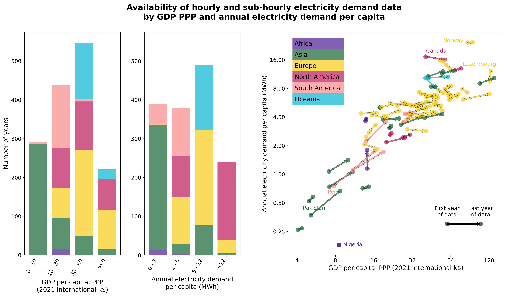

# Current state

This page shows, at a high level, the electricity demand data that DemandCast retrieves and the errors of the forecasts of its models. Its figures and numbers are drawn by `plot.py` with `figure: status` (see [Analyzing and plotting data](plot.md)).

## Data

--8<-- "status/numbers.md"

The map shows the countries and subdivisions for which retrieval modules of electricity demand data are available, with the years of their data.

The figure below shows the years of data by GDP PPP per capita and by annual electricity demand per capita, by continent, and how they changed in each country between its first and last year of data. It shows which kinds of countries the training data covers, and therefore where the models extrapolate when they forecast the demand of the countries without data.

The [data retrieval](retrieval.md) page describes the data sources, and how their data is cleaned and combined.

## Forecast errors

This section will show the mean absolute percentage error (MAPE) of the model whose forecasts are published on [Zenodo](https://doi.org/10.5281/zenodo.18374351): on the countries and subdivisions left out of its training, as for the countries without data, and on the most recent year of each one, by continent and by GDP PPP per capita, and against the models trained on the data of each group (see [issue #326](https://github.com/open-energy-transition/demandcast/issues/326)). The [machine learning](ML.md) page describes the models and how they are validated.
